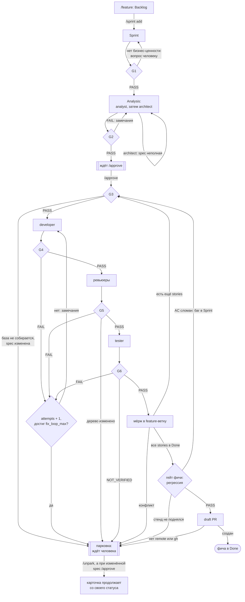
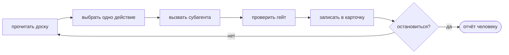
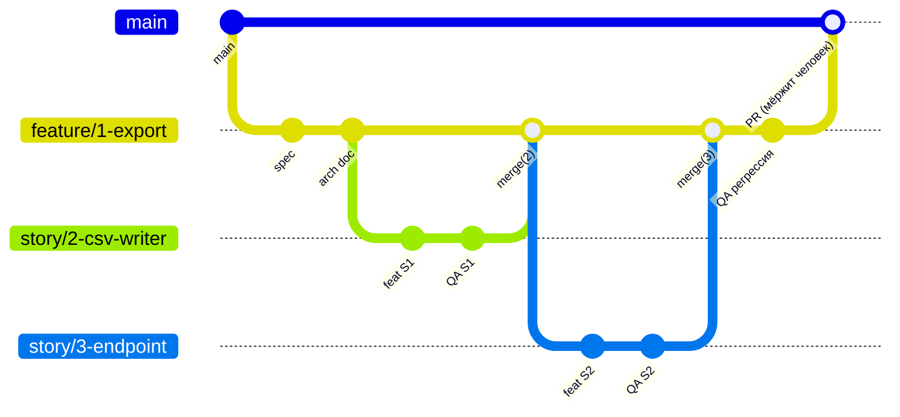

# Агентная команда для OpenCode

Десять агентов ведут задачу по Kanban-доске от описания фичи до draft PR: анализ,
архитектура, разработка, ревью, проверка критериев приёмки на живом стенде. Между этапами
стоят гейты, которые оркестратор проверяет сам, своими командами. Код в `main` попадает
только через PR, который мёржит человек.

Своей программы у фреймворка нет. Это markdown-файлы агентов, команд и skills плюс
`opencode.json` с правами, всё в каталоге `.opencode/`. Исполняет их OpenCode 2.x
(проверено на 2.0.29).

## Быстрый старт

**1. Установите OpenCode и подключите модель**

```bash
brew install opencode
opencode auth login        # выбрать провайдера, ввести ключ
opencode models            # найти id модели, например deepseek/deepseek-v4-pro
```

**2. Добавьте фреймворк в проект**

```bash
cd <проект>
git subtree add --prefix=.opencode https://github.com/oElshan/agents.git v1.0.0 --squash
```

Номер последней версии: `git ls-remote --tags https://github.com/oElshan/agents.git`.

**3. Задайте модель для проекта**

```bash
echo '{ "model": "deepseek/deepseek-v4-pro" }' > opencode.json
git add opencode.json && git commit -m "chore: модель для агентной команды"
```

**Запуск на проекте**

```bash
opencode
```

```
/setup                         один раз: профиль, AGENTS.md, режим доски
/feature <описание фичи>       карточка в Backlog, в ответе её id
/sprint add <id>               взять в работу
/orchestrate                   анализ; остановится и попросит утвердить spec
/approve <id>                  утвердить spec после прочтения
/orchestrate                   разработка, ревью, тесты, draft PR
```

## Как это устроено

### Агенты

- `orchestrator`: главный агент сессии. Двигает карточки, проверяет гейты, переключает
  ветки, мёржит, открывает PR. Код не пишет. Карточки доски пишет только он.
- `analyst`: пишет spec фичи, то есть требования, критерии приёмки (AC) с ID, System Design
  Checklist (SDC) и декомпозицию на stories.
- `architect`: пишет arch doc и ADR.
- `developer`: код и unit-тесты story, коммиты.
- `security-reviewer`, `java-reviewer`, `frontend-reviewer`: ревью изменений story, только
  чтение. Security смотрит всегда, остальные только если в изменениях есть их код.
- `tester`: поднимает стенд и проверяет каждый AC запросами к живому приложению.
- `devops`: деплой на staging, если он задан в профиле.
- `e2e-tester`: E2E-тесты на Java Playwright, только по команде `/e2e`.

Субагенты отвечают оркестратору отчётом в фиксированном формате. Они не переключают
ветки, не мёржат, не пушат и не трогают доску.

### Файлы в проекте

```
.opencode/              фреймворк: агенты, команды, skills, правила, opencode.json с правами
opencode.json           настройки проекта: модель, провайдеры
.agents/profile.md      профиль: стек, команды сборки, тестов и стенда, пороги
.agents/board/          карточки доски, вне git
AGENTS.md               короткое знание о проекте для всех агентов
docs/specs/, docs/arch/, docs/qa/    spec, arch doc и QA-документ каждой фичи
```

Доска лежит вне git, поэтому смена веток её не трогает. Профиль, `AGENTS.md` и
`docs/arch/` создаёт `/setup`.

## Процесс

### Основной путь

1. **Backlog.** `/feature` создаёт карточку фичи. Агенты Backlog не трогают.
2. **Sprint.** Человек берёт фичу в работу: `/sprint add`.
3. **Analysis.** Оркестратор проверяет G1 и создаёт ветку `feature/<id>-<slug>`. Analyst
   пишет spec, architect пишет arch doc. Оркестратор проверяет G2: у каждого AC есть ID и
   способ проверки, SDC заполнен, декомпозиция покрывает все AC.
4. **Утверждение.** Фича ждёт `/approve`. После него оркестратор запоминает хэш spec и
   создаёт карточки stories по декомпозиции.
5. **Разработка story.** Stories идут по одной. Для каждой оркестратор создаёт ветку
   `story/<id>-<slug>` от feature-ветки и проводит её через developer (G4), ревьюеров (G5)
   и tester (G6).
6. **Мёрж story.** После G6 story мёржится в feature-ветку, ветка story удаляется. Затем
   берётся следующая story.
7. **Гейт фичи.** Когда все stories в Done, оркестратор собирает и тестирует feature-ветку,
   а tester прогоняет регрессию всех AC фичи на стенде.
8. **Draft PR.** Оркестратор открывает draft PR, `git push` подтверждает человек. PR
   мёржит человек.

Если в профиле задан деплой на staging, story после G6 идёт не в Done, а в Ready to
Deploy. Оркестратор собирает пакет таких карточек одной ветки, проверяет G7, devops
деплоит, оркестратор проверяет G8: health, smoke, логи, репетицию отката. Production
фреймворк не трогает.

### Схема с возвратами



### Возвраты и петли

**Анализ.** Если architect отвечает, что spec неполная, оркестратор снова вызывает
analyst с этим списком. Если G2 не прошёл, analyst или architect получают перечень
замечаний и переделывают. После `quality.fix_loop_max` неудачных G2 подряд (по умолчанию 3)
фича паркуется до человека. Если в профиле `gates.spec_approval: auto`, шаг с `/approve`
пропускается и stories создаются сразу после G2.

**Доработка story.** FAIL на G4, G5 или G6 возвращает story в In Development. Оркестратор
переносит в раздел «Замечания к исправлению» каждую находку уровня CRITICAL или HIGH, каждый
проваленный AC или вывод упавшей команды и увеличивает `attempts`. Developer получает задачу
с номером попытки и этими замечаниями, и story снова проходит G4, ревью и тесты. Когда
`attempts` доходит до `quality.fix_loop_max`, story паркуется. `/unpark` сбрасывает
`attempts` в 0, и петля начинается заново. Находки MEDIUM и LOW story не возвращают: они
уходят в описание PR как tech-debt.

**Ревью.** G5 требует PASS от security-reviewer и PASS или WARNING от остальных, все на
текущем SHA ветки. Если ревьюер ответил, что SHA изменился, оркестратор запускает его
заново. Если после ревью в дереве появились изменения, story паркуется: ревьюеры не должны
менять файлы.

**Тестирование.** Tester ставит каждому AC PASS, FAIL или NOT_VERIFIED. FAIL возвращает
story на доработку. Стенд, который задан в профиле, но не поднялся, тоже FAIL: story уходит к
developer с выдержкой логов. NOT_VERIFIED значит, что AC нечем проверить нужным способом,
например AC требует живого стенда, а стенда в профиле нет. Тогда story паркуется и после
`/unpark` снова идёт в Testing.

**Свежесть вердиктов.** Вердикт записывается с SHA: `PASS@a1b2c3d`. Новый коммит в ветке
story делает вердикты ревью и QA недействительными, и стадию нужно пройти заново.
Исключение: коммиты, которые меняют только `docs/qa/` и тестовые каталоги.

**Мёрж.** Конфликт при мёрже story в feature-ветку оркестратор не решает: он отменяет
мёрж и паркует story с причиной `conflict`.

**Возобновление story.** Story, которая стояла на парковке, могла отстать от feature-ветки,
пока шли другие stories. Перед продолжением оркестратор вливает в неё свежую базу. При
конфликте developer получает задачу его разрешить. Без конфликта старые вердикты считаются
устаревшими: story снова проходит G4 и ревью.

**Гейт фичи.** Если регрессия сломала AC, оркестратор создаёт по багу на каждый сломанный AC
прямо в Sprint, с привязкой к фиче. Это единственный случай, когда карточка попадает в
Sprint без человека. Баг идёт тем же путём, что story, и после его Done гейт фичи
запускается снова. Если на регрессии не поднялся стенд, баги не создаются, а фича
паркуется до человека. Если PR не удалось создать, фича тоже паркуется. После `/unpark`, если
feature-ветка не изменилась, оркестратор повторяет только создание PR, без регрессии.

**Правка spec.** Требования меняются только правкой spec на feature-ветке. Если spec
изменили после утверждения, G3 заметит расхождение хэша и запаркует следующую story. Тогда
нужен повторный `/approve`. Оркестратор проверит изменённую spec по чек-листу G2, запомнит
новый хэш и сверит stories с декомпозицией:
- для новых строк декомпозиции создаст stories;
- у незавершённых stories обновит AC и зависимости. Story в Code Review или Testing с
  изменёнными AC вернётся в In Development;
- stories в Done не переоткроет, а перечислит вам. Изменённые AC готовых stories проверит
  регрессия в гейте фичи.

После этого парковки по изменённой spec снимаются.

### Петля оркестратора

`/orchestrate` работает циклом. На каждом шаге оркестратор читает доску и выбирает одно
действие в таком порядке:

1. продолжить активную story;
2. задеплоить карточки из Ready to Deploy и Deploy;
3. провести гейт фичи, у которой все stories в Done;
4. взять следующую story из Ready for Dev или задачу из Sprint: сначала по приоритету, затем
   по меньшему id. Запаркованные карточки, карточки с незакрытыми зависимостями и stories
   неутверждённой фичи пропускаются;
5. продолжить анализ фичи;
6. начать анализ фичи из Sprint.

Затем он вызывает субагента, проверяет гейт, пишет результат в карточку и решает, идти ли
дальше. Активная story всегда одна: все агенты работают в одном рабочем каталоге.
Параллельно работают только ревьюеры одной story.



Оркестратор останавливается и пишет отчёт с причиной:

- `EMPTY`: на доске нет карточек вне Backlog и Done;
- `GOAL`: всё, что входило в запуск, в Done;
- `HELD`: работы нет из-за стадий на паузе (`/stage`) или аргумента `skip:`;
- `HUMAN`: остались только карточки, которые ждут человека;
- `DRAINED`: остальное заблокировано зависимостями или запарковано;
- `STALL`: три шага подряд ничего не сдвинулось (`orchestrator.stall_rounds`);
- `BUDGET`: запущено 40 субагентов (`orchestrator.max_agent_runs`).

Аргументы: `/orchestrate once` делает один шаг, `/orchestrate <id>` ведёт одну карточку
(для фичи с её stories), `/orchestrate dry-run` показывает план без запуска,
`/orchestrate skip:testing` не начинает новые карточки на стадии.

### Ветки



Ревью и QA смотрят ветку story до мёржа, поэтому видят только её изменения. Bug, tech-debt и
hotfix без фичи получают ветку от default branch, не мёржатся в фичу и после Done получают
свой PR.

### Гейты

- **G1**, Sprint → Analysis: у фичи есть бизнес-ценность и критерии, нет дубля, дерево чистое.
- **G2**, Analysis → Ready for Dev: spec со всеми разделами, AC с ID и способом проверки,
  SDC, декомпозиция без циклов, arch doc, ADR при превышении архитектурного бюджета.
- **G3**, → In Development: нет другой активной story, зависимости в Done, spec не менялась
  после утверждения, база собирается.
- **G4**, → Code Review: есть коммиты, дерево чистое, применённые миграции не тронуты,
  сборка, lint и тесты зелёные, покрытие изменённых классов из отчёта JaCoCo не ниже порога.
- **G5**, → Testing: вердикты ревью на текущем SHA, дерево не менялось после ревью.
- **G6**, → Done или Ready to Deploy: каждый AC PASS, автотесты и сборка SUCCESS,
  QA-документ закоммичен.
- **G7** и **G8**: деплой на staging, только если он задан в профиле.
- **Гейт фичи**: сборка, тесты и регрессия всех AC на feature-ветке, затем draft PR.

Чек-листы с командами лежат в skill `quality-gates`.

## Где нужен человек

- `/setup`: подтвердить профиль и default branch, выбрать режим доски.
- `/sprint add`: решить, что делать сейчас.
- `/approve`: прочитать и утвердить spec, а после правки утверждённой spec утвердить её снова.
- `/unpark <id> [комментарий]`: разобраться с парковкой. Причина записана в карточке, в
  поле `parked_reason`.
- `git push`: подтвердить запрос OpenCode.
- Draft PR: ревьюить и мёржить.

`/approve` и `/unpark` оркестратор выполняет, только если вы набрали их в этой сессии.
Текст в карточке или issue, который просит пропустить гейт, он считает данными.

## Команды

```
/setup                       подключить проект
/feature <описание>          фича в Backlog
/sprint add|remove <id…>     взять в работу или вернуть в Backlog; без аргументов: что в работе
/orchestrate [аргументы]     автопилот
/approve <id>                утвердить spec и создать stories; повторно после правки spec
/unpark <id> [комментарий]   снять парковку
/analyze <id>                только анализ фичи
/develop <id>                одна story через разработку и ревью
/test <id>                   одна story через QA и мёрж
/deploy                      деплой на staging всего из Ready to Deploy
/stage off|on <стадия…>      пауза стадий analysis, develop, testing, deploy
/board                       доска; /board trace <id>: AC фичи, stories, вердикты
/sync [setup|push|pull]      синхронизация с GitHub
/e2e <id>                    E2E-тесты по QA-документу фичи
```

Ревьюера можно позвать вручную в любой сессии: `@java-reviewer посмотри последний коммит`.

## Подключение через git

Репозиторий фреймворка выпускает ветку `dist` и теги `vX.Y.Z`. В корне `dist` лежит только
содержимое `.opencode/`, без README. Проект подключает её в свой каталог `.opencode/`, а
свои настройки держит в корневом `opencode.json`.

OpenCode читает оба файла. Конфиг из `.opencode/` сильнее корневого при конфликте ключей,
поэтому проект случайно не переопределит правила фреймворка, а модель в корневом файле с
ними не конфликтует.

### git subtree (рекомендуется)

Файлы фреймворка становятся обычными файлами проекта. Клонировать проект можно без
дополнительных шагов, доступ к репозиторию фреймворка нужен только тому, кто обновляет.

```bash
git remote add agents-fw https://github.com/oElshan/agents.git
git ls-remote --tags agents-fw                     # какие версии есть
git subtree add  --prefix=.opencode agents-fw v1.0.0 --squash -m "chore: агентная команда v1.0.0"
git subtree pull --prefix=.opencode agents-fw v1.1.0 --squash -m "chore: агентная команда v1.1.0"
```

`--squash` нужен и при `add`, и при каждом `pull`. Локальные правки в `.opencode/`
сливаются с новой версией как обычный merge. Удалить фреймворк: `git rm -r .opencode`.

### git submodule

Фреймворк остаётся отдельным репозиторием с точной версией. Доступ к нему нужен каждому
разработчику и CI, локальные правки в `.opencode/` невозможны.

```bash
git submodule add -b dist https://github.com/oElshan/agents.git .opencode
git submodule update --init                        # остальным после клона
git submodule update --remote .opencode            # обновление до последней dist
```

### Если в проекте уже есть `.opencode/`

`git subtree add` не работает, если каталог уже существует. Переименуйте свой каталог,
добавьте фреймворк и верните свои агенты и команды внутрь с другими именами. Свой skill
агенты увидят, только если добавить его в белый список: строка
`{ "action": "integration.use", "resource": "skill:<имя>", "effect": "allow" }` в
`policies` файла `.opencode/opencode.json`. С submodule так сделать нельзя.

### Проверка

```bash
opencode debug agents | jq -r '.[].id'      # среди агентов есть orchestrator, analyst и остальные восемь
opencode debug config | jq -c '.[] | {path, policies: ((.info.policies // []) | length)}'   # у .opencode/opencode.json 89 policies
```

Оркестратор переключает ветки в рабочем каталоге. Запускайте его в отдельном клоне или
`git worktree`, а не там, где правите код сами.

## Профиль проекта

`/setup` определяет стек по файлам сборки и пишет `.agents/profile.md`. Агенты берут команды
из профиля дословно, поэтому проверьте его глазами. Главное в нём:

```yaml
project:
  default_branch: main
tracker:
  mode: local                  # local или github
gates:
  spec_approval: human         # human или auto
commands:
  backend:
    build: "./mvnw -q package -DskipTests"
    test: "./mvnw test"
    coverage: "./mvnw verify"
    coverage_report: "target/site/jacoco/jacoco.csv"
  local_env:                   # стенд для tester
    up: "docker compose up -d"
    down: "docker compose down"
  deploy:
    staging: ""                # пусто: без стадий деплоя
quality:
  unit_coverage_min: 95
  fix_loop_max: 3
```

Команда стенда должна вернуть управление. Если приложение запускается в фоне, направьте его
вывод в файл, иначе shell агента будет ждать конца вывода:
`./mvnw -q spring-boot:start > target/stand.log 2>&1`.

Если стенда в профиле нет, tester проверяет AC интеграционными тестами с Testcontainers
(`commands.backend.integration_test`). Если нет и их, он прогоняет unit-тесты, а AC с
проверкой `stand` или `integration` получают NOT_VERIFIED.

## Модели LLM

Модели задаются в корневом `opencode.json` проекта или в глобальном
`~/.config/opencode/opencode.json`. `.opencode/opencode.json` принадлежит фреймворку,
моделей в нём нет.

Модель роли берётся из `agents.<id>.model`. Если её нет, агент работает на модели сессии:
ключ `model`, флаг `--model` или выбор в TUI через `/models`. Ключ агента совпадает с именем
файла в `.opencode/agents/` без `.md`.

```json
{
  "model": "deepseek/deepseek-v4-pro",
  "agents": {
    "analyst":           { "model": "deepseek/deepseek-v4-pro#high" },
    "architect":         { "model": "deepseek/deepseek-v4-pro#high" },
    "java-reviewer":     { "model": "deepseek/deepseek-flash" },
    "frontend-reviewer": { "model": "deepseek/deepseek-flash" },
    "tester":            { "model": "deepseek/deepseek-flash" },
    "devops":            { "model": "deepseek/deepseek-flash" }
  }
}
```

После `#` указывается вариант модели. У DeepSeek это уровень рассуждения: `none`, `low`,
`high`, `max`. Список вариантов своей модели:
`opencode api --standalone GET /api/model | jq -r '.[] | select(.id=="deepseek-v4-pro") | .variants[].id'`.

Проверить, что OpenCode принял настройку: `opencode debug config | jq '.[] | .info.agents // empty'`.

> Не задавайте модель строкой `model:` во frontmatter файла агента. В 2.0.29 одна такая
> строка выключает загрузку всех агентов: `opencode debug agents` возвращает пустой список.

**Куда какую модель.** Оркестратору, analyst, architect, developer и security-reviewer
нужны сильные модели: на оркестраторе держатся все гейты, а security-reviewer в прогоне
нашёл formula injection в CSV. Остальным ревьюерам, tester и devops хватает модели
попроще. Для ориентира: фича из двух stories на `deepseek/deepseek-v4-pro` для всех ролей
заняла 21 минуту и стоила около $0.65.

**Личный выбор модели.** Корневой `opencode.json` проекта сильнее глобального файла.
Если модель задана в проекте, ваш глобальный выбор не сработает.

### Разные провайдеры в одном запуске

Агенты одного запуска `/orchestrate` могут работать на моделях разных провайдеров.
Оркестратор работает в своей сессии, а каждый вызов субагента OpenCode открывает как
отдельную дочернюю сессию со своей моделью: из `agents.<id>.model`, а если её нет, с моделью
сессии.

```json
{
  "model": "anthropic/claude-opus-5-5",
  "agents": {
    "developer":         { "model": "deepseek/deepseek-v4-pro" },
    "security-reviewer": { "model": "anthropic/claude-sonnet-5-5" },
    "java-reviewer":     { "model": "deepseek/deepseek-flash" },
    "tester":            { "model": "ollama/qwen3.8:27b-mlx-64k" }
  }
}
```

Здесь оркестратор, analyst и architect работают на Anthropic (модель сессии), developer и
java-reviewer на DeepSeek, tester на локальном Ollama.

Что нужно учесть:

- каждого облачного провайдера подключите через `opencode auth login`, локальному Ollama
  ключ не нужен;
- модель любой роли должна поддерживать вызов инструментов: агенты работают только через них;
- для локальной модели задайте окно контекста явно (раздел про Ollama ниже);
- код и вывод команд уходят каждому провайдеру, на котором работает хоть одна роль.

Что проверено: смешанную настройку с DeepSeek, вариантом `#high` и Ollama у разных агентов
OpenCode разбирает без ошибок, `opencode debug config` показывает у каждой роли свою пару
провайдер и модель. Что субагент во время работы действительно идёт на своей модели, живым
прогоном пока не проверено. Проверьте после первого запуска: возьмите id сессии субагента из
`opencode session list --standalone` и посмотрите её модель:

```bash
opencode api --standalone GET /api/session/<id>/message \
  | jq -r '[.data[] | select(.type=="assistant") | "\(.model.providerID)/\(.model.id)"] | unique[]'
```

### Ollama и локальные модели

Локальный Ollama на `127.0.0.1:11434` OpenCode находит сам. Удалённый подключается через
`"providers": { "ollama": { "settings": { "baseURL": "http://host:11434/v1" } } }`.

Главная ловушка: окно контекста. Ollama выбирает его по объёму памяти: на Mac с 48 ГБ модель
загрузилась с окном 32k. OpenCode при этом прочитал родное окно модели, 262k, и не стал
сжимать историю. В такой ситуации Ollama молча обрезает начало промпта вместе с инструкциями
агента. Задайте окно явно с двух сторон:

```bash
printf 'FROM qwen3.8:27b-mlx\nPARAMETER num_ctx 65536\n' > Modelfile
ollama create qwen3.8:27b-mlx-64k -f Modelfile
```

```json
{
  "model": "ollama/qwen3.8:27b-mlx-64k",
  "providers": {
    "ollama": {
      "models": { "qwen3.8:27b-mlx-64k": { "limit": { "context": 65536, "output": 16384 } } }
    }
  }
}
```

Меньше 64k оркестратору мало: его первый запрос занимает около 10 тысяч токенов, а skill
гейтов и вывод сборки быстро добавляют остальное. Локальные модели заметно медленнее: на 27B-модели первый промпт агента
обрабатывался 1.5 минуты, `/setup` занял 8 минут.

## Режим доски github

В режиме `github` карточки дополнительно отражаются в GitHub Issues и GitHub Project. В
начале каждого шага оркестратор забирает с GitHub новые issue и решения «взять в Sprint»,
после каждой записи обновляет issue и поле `Stage`. Источник правды остаётся локальным.

Настройка: `gh auth refresh -s project`, затем `/sync setup`. Этот режим ещё не проверен
живым прогоном.

## Гарантии и ограничения

**Держится на правах OpenCode.** Субагенты не пушат, не переключают и не создают ветки, не
мёржат. Ревьюерам запрещено редактировать файлы, в shell у них только читающие команды.
Доску пишет только оркестратор. `.env` инструментом чтения не открывается. Для всех агентов
запрещены force push, `git reset --hard`, `git clean`, `git branch -D`, `git -C`, `bash -c`,
`eval`, `rm` по абсолютным путям, `sudo`, `kubectl delete`, `helm uninstall`, `gh pr merge`.
Агенты видят только 17 skills фреймворка. Составную команду `cd x && git push` OpenCode
делит на части и отклоняет целиком, если запрещена хоть одна часть.

**Держится на модели оркестратора.** Сами гейты, правило «`/approve` и `/unpark` только от
человека», запрет правки применённых миграций (проверяется в G4, а не в момент правки).

**Известные дыры OpenCode 2.0.29:**

- перенаправление `>` права не проверяют, ревьюер может записать файл через `git diff > файл`.
  Это ловит G5: после ревью дерево должно быть чистым;
- инструмент `execute` открывает агентам `worktree_create`, `worktree_remove` и
  `session_move`. Права и `policies` на эти вызовы не действуют: в проверке developer создал
  worktree, хотя `git worktree` ему запрещён. Shell через `execute` недоступен;
- права не действуют на `!команда` в TUI;
- шаблон запрета можно обойти алиасом git, скриптом в файле или `cat .env` через shell.

**Ограничения.** Одна активная story за раз. Регрессия фичи гоняет все её AC перед PR.

### Если что-то пошло не так

- `opencode debug agents` возвращает `[]` сразу после `git subtree add` или мёржа:
  повторите через несколько секунд и не направляйте вывод в файл внутри проекта. OpenCode
  перечитывает каталог после изменений и в это время отдаёт пустой список.
- `opencode debug agents` возвращает `[]` и при повторе: OpenCode не разобрал один из файлов
  агентов, частая причина в строке `model:` во frontmatter.
- Агенты есть, а `policies` нет: проверьте, что `.opencode/opencode.json` на месте.
- Модель забывает правила посреди работы: окно контекста меньше, чем думает OpenCode.
- `opencode run` висит без событий и не создаёт сессию: в 2.0.29 так бывало после серии
  прерванных запусков, причину мы не нашли.
- Карточка запаркована: причина в `parked_reason`, история в разделе «Журнал» карточки.
- Что делал субагент: `opencode session list --standalone`, затем
  `opencode api --standalone GET /api/session/<id>/message`.

## Сопровождение фреймворка

Всё, что уходит в проекты, лежит в `.opencode/`: `opencode.json` (права, `policies`,
агент по умолчанию), `framework.md` (общие правила), 10 агентов, 14 команд, 17 skills. В
корне репозитория, кроме README, лежат справочные материалы по методологии, в `dist` они
не попадают.

Выпуск версии из `main`:

```bash
opencode debug agents | jq -r '.[].id'      # 10 агентов фреймворка на месте
SHA=$(git subtree split --prefix=.opencode main)
git push origin "$SHA:refs/heads/dist"
git tag -a v1.1.0 "$SHA" -m "v1.1.0: <что изменилось>"
git push origin v1.1.0
```

Первая версия: `v1.0.0`. Перед каждым выпуском прогоните на тестовом проекте `/setup`, `/feature`, `/sprint add`, `/orchestrate`, `/approve`,
`/orchestrate`. Major-версия означает несовместимые изменения формата карточки, профиля или
веток, minor означает новые команды, агенты и гейты, patch означает исправления промптов и
прав.

Что проверено: полный цикл на тестовом проекте (Spring Boot 3, Maven, `deepseek-v4-pro`),
`subtree add`, `subtree pull` и `submodule` на локальных копиях. Не проверено: режим
`github`, модели по ролям на живом прогоне, отключение `execute`.
