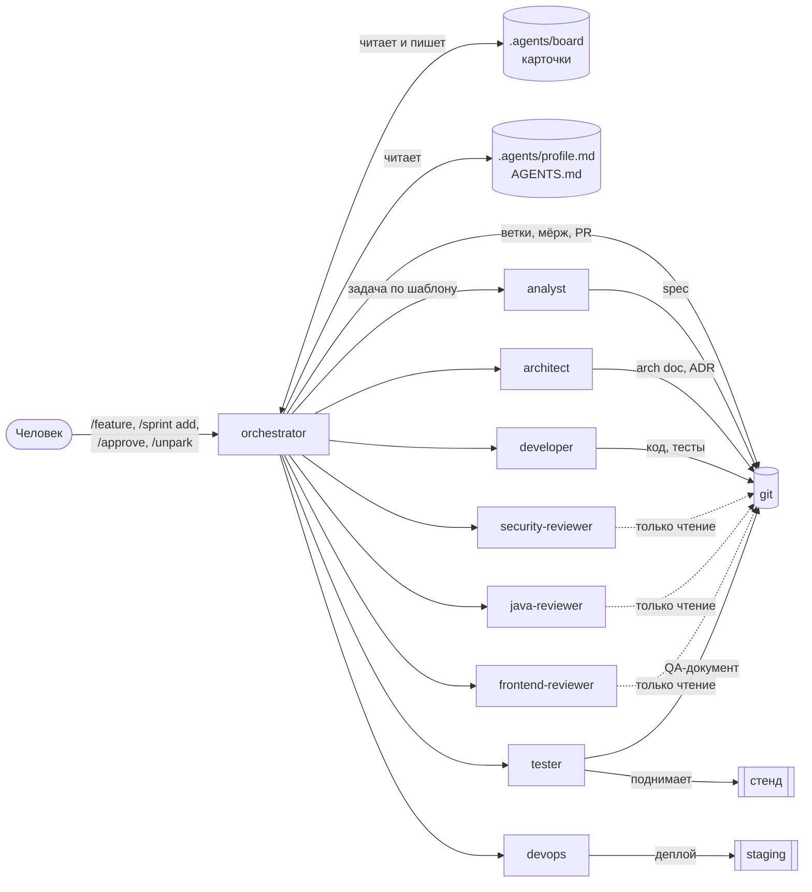
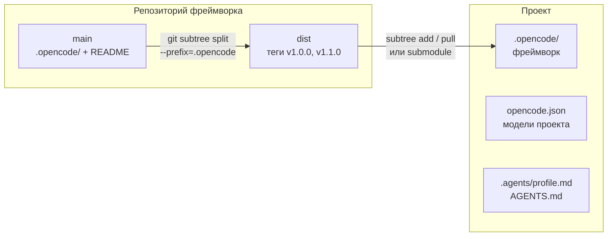
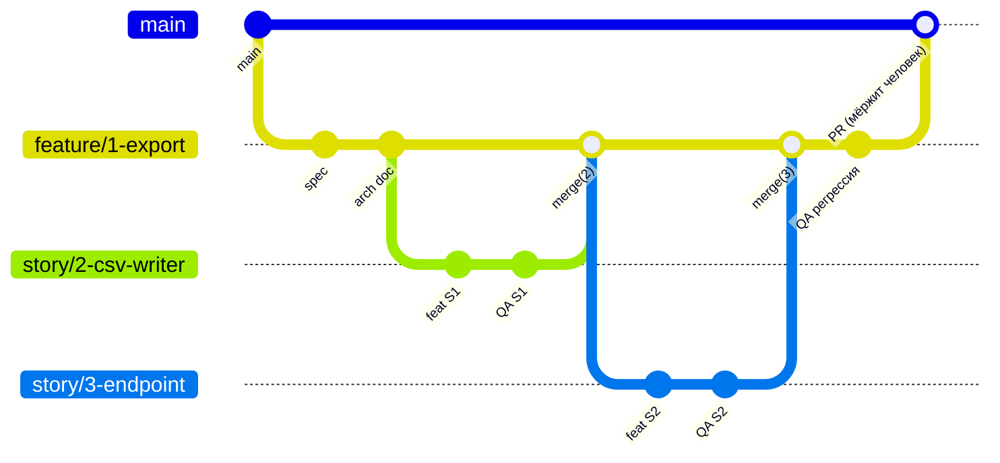
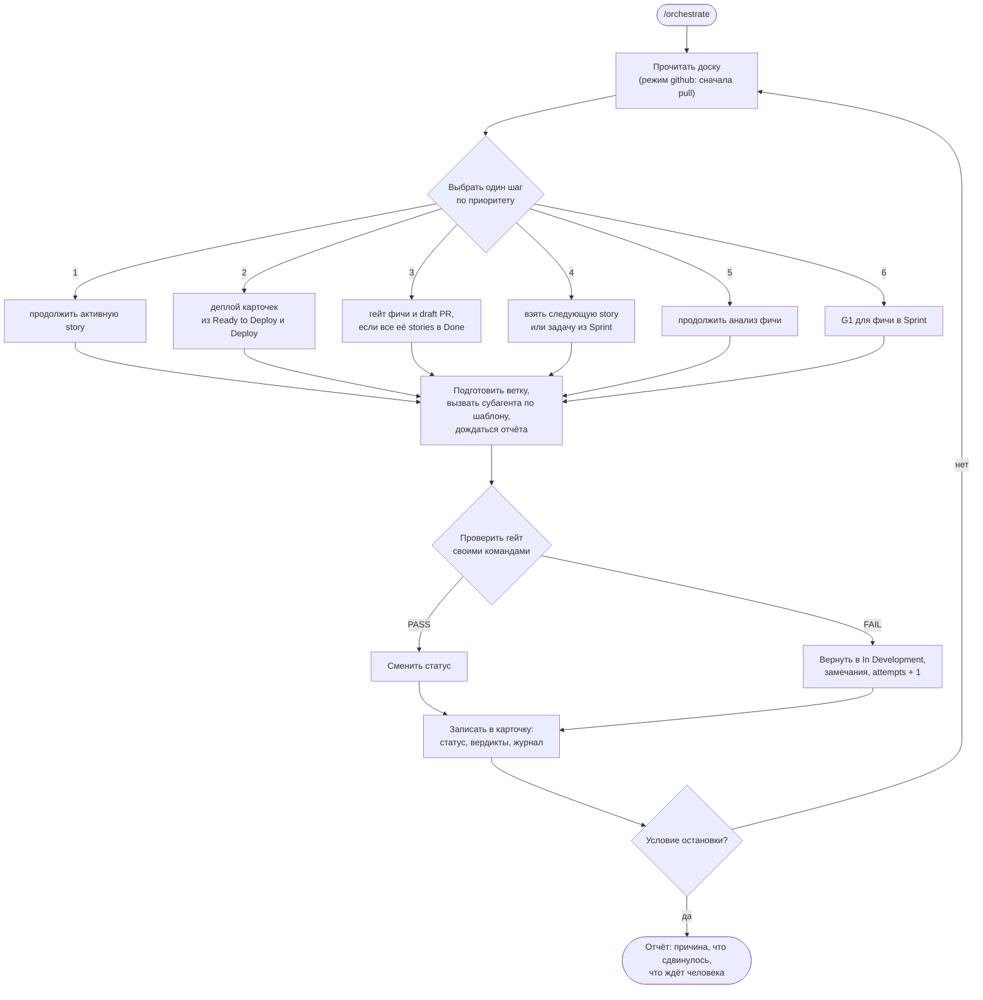
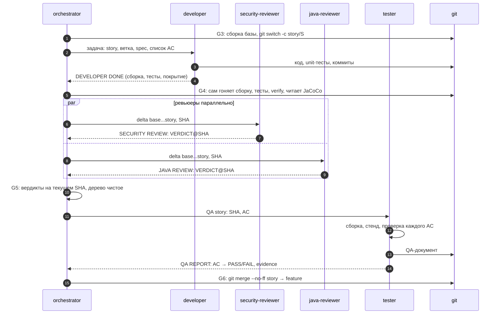

# Агентная команда для OpenCode

Команда из десяти агентов, которая ведёт задачу по Kanban-доске от фичи до draft PR: анализ,
архитектура, разработка, ревью, проверка критериев приёмки на живом стенде, деплой на
staging. Документ рассчитан на тех, кто подключает фреймворк впервые: из чего он состоит, как
подключить его к любому проекту через git, как идёт работа и как настроить модели LLM для
каждой роли.

Своей программы у фреймворка нет. Это markdown-файлы агентов, команд и skills плюс
`opencode.json` с правами, всё в одном каталоге `.opencode/`. Исполняет их OpenCode.

Цифры и примеры в тексте взяты из живого прогона 25 октября 2026 года: тестовый сервис на
Spring Boot 3 и Maven, фича «Экспорт заказов в CSV» из двух stories, модель
`deepseek/deepseek-v4-pro`, OpenCode 2.0.29.

## Содержание

1. [Что это и как это выглядит](#1-что-это-и-как-это-выглядит)
2. [Словарь](#2-словарь)
3. [Из чего состоит фреймворк](#3-из-чего-состоит-фреймворк)
4. [Подключение к проекту через git](#4-подключение-к-проекту-через-git)
5. [Первый прогон шаг за шагом](#5-первый-прогон-шаг-за-шагом)
6. [Доска и карточки](#6-доска-и-карточки)
7. [Схема работы: статусы и гейты](#7-схема-работы-статусы-и-гейты)
8. [Оркестрация](#8-оркестрация)
9. [Роли агентов](#9-роли-агентов)
10. [Команды](#10-команды)
11. [Где нужен человек](#11-где-нужен-человек)
12. [Профиль проекта](#12-профиль-проекта)
13. [Настройка моделей LLM](#13-настройка-моделей-llm)
14. [Режим доски github](#14-режим-доски-github)
15. [Что гарантирует конфиг, а что нет](#15-что-гарантирует-конфиг-а-что-нет)
16. [Диагностика и частые проблемы](#16-диагностика-и-частые-проблемы)
17. [Сопровождение фреймворка](#17-сопровождение-фреймворка)

## 1. Что это и как это выглядит

Вы описываете фичу одной фразой, берёте её в работу, и агент-оркестратор ведёт её по доске:

- analyst пишет spec с критериями приёмки;
- architect пишет архитектурный документ;
- вы утверждаете spec;
- developer пишет код и тесты;
- ревьюеры проверяют код;
- tester поднимает приложение и проверяет каждый критерий запросами к живой системе;
- оркестратор мёржит результат и открывает draft PR.

Между этапами стоят гейты: проверки, которые оркестратор выполняет сам, командами, а не по
словам субагентов. Код в `main` попадает только через PR, который мёржит человек.

В прогоне фича из двух stories прошла путь от `/feature` до регрессии всех критериев за 21
минуту и стоила около $0.65 на DeepSeek V4 Pro. Человек набрал пять команд, не считая
разового `/setup`.

## 2. Словарь

| Термин | Что значит |
|---|---|
| Агент | Роль с собственным промптом и правами, файл в `.opencode/agents/` |
| Primary-агент | Агент, с которым вы говорите в сессии. Здесь это `orchestrator` |
| Субагент | Агент, которого вызывает оркестратор. Работает в отдельной сессии и возвращает отчёт |
| Команда | `/feature`, `/orchestrate` и так далее. Файл в `.opencode/commands/`, заготовленный промпт |
| Skill | Процедура или чек-лист, который агент загружает, когда нужно. Каталог в `.opencode/skills/` |
| Карточка | Задача на доске, файл `.agents/board/<id>.md` |
| Фича | Крупная задача, делится на stories |
| Story | Часть фичи, которую можно сделать, проверить и смёржить отдельно |
| AC | Критерий приёмки, acceptance criterion. ID вида `AC-1-03`: фича 1, критерий 3 |
| Spec | Документ требований фичи в `docs/specs/` проекта |
| SDC | System Design Checklist: восемь вопросов о дизайне в spec (идемпотентность, миграции, откат и т.п.) |
| Гейт | Проверка перед сменой статуса карточки: G1–G8 и гейт фичи |
| Вердикт | Результат ревью или QA с SHA коммита: `PASS@a1b2c3d` |
| Парковка | Карточка остановлена и ждёт человека, зависимостей или разрешения конфликта |
| Стенд | Запущенное приложение, на котором tester проверяет AC |
| Профиль | `.agents/profile.md`: стек, команды сборки, тестов и стенда, пороги |

## 3. Из чего состоит фреймворк

### Каталог `.opencode/`

Это всё, что попадает в проект:

```
.opencode/
  opencode.json      права по умолчанию, policies (жёсткие запреты), белый список skills,
                     агент по умолчанию, подключение framework.md
  framework.md       общие правила, OpenCode добавляет их в промпт каждого агента
  agents/            10 агентов
  commands/          14 команд
  skills/            17 skills с шаблонами
```

### Что появляется в проекте после `/setup` и работы

```
opencode.json                  настройки проекта: модели, провайдеры (раздел 13), в git
.agents/profile.md             профиль проекта, в git
.agents/board/                 карточки доски, вне git
.agents/cache/                 служебные файлы: описание PR, параметры GitHub, вне git
AGENTS.md                      короткое знание о проекте для всех агентов, в git
docs/arch/budget.md            учёт архитектурной сложности
docs/arch/ownership-map.md     кто владеет таблицами, endpoints, очередями
docs/specs/<F>-<slug>.md       spec фичи (пишет analyst)
docs/arch/<F>-<slug>.md        arch doc фичи (пишет architect)
docs/qa/<F>-<slug>.md          QA-документ фичи (пишет tester)
```

Доска лежит вне git специально: оркестратор переключает ветки, а карточки при этом не
меняются.

### Общая схема



Субагенты отвечают оркестратору отчётом в фиксированном формате. Карточки пишет только
оркестратор.

## 4. Подключение к проекту через git

### Как устроена раздача

Репозиторий фреймворка выпускает ветку `dist` и теги версий `vX.Y.Z`. В корне `dist` лежит
ровно содержимое каталога `.opencode/`: агенты, команды, skills, `framework.md` и
`opencode.json`. README и справочные материалы в `dist` не попадают.

Проект подключает `dist` в свой каталог `.opencode/`. Настройки самого проекта (модели,
провайдеры, MCP-серверы) лежат отдельно, в корневом `opencode.json` проекта, и обновление
фреймворка их не трогает.



Почему так работает: OpenCode читает конфиг и из корневого `opencode.json`, и из
`.opencode/opencode.json`. По документации OpenCode конфиг из `.opencode/` перекрывает
корневой при конфликте ключей, а неконфликтующие ключи сохраняются из обоих файлов. Правила
фреймворка проект случайно не переопределит, а модели в корневом файле с ними не
конфликтуют. Относительный путь `.opencode/framework.md` в `instructions` OpenCode ищет от
рабочего каталога к корню проекта, поэтому он работает из `.opencode/opencode.json`.

Есть два способа подключения. Выбирайте subtree, если нет причин для submodule.

| | `git subtree` (рекомендуется) | `git submodule` |
|---|---|---|
| Где лежат файлы | обычные файлы в репозитории проекта | отдельный репозиторий, в проекте ссылка на коммит |
| Клон проекта | `git clone`, больше ничего | `git clone --recurse-submodules` или `git submodule update --init` |
| Доступ к репозиторию фреймворка | нужен только тому, кто обновляет | нужен каждому разработчику и CI |
| Локальные правки фреймворка | можно, при обновлении они сливаются как обычный merge | нельзя без своего форка |
| Версия | видна в сообщении коммита обновления | точный SHA, `git submodule status` |
| Обновление | `git subtree pull` | `git submodule update --remote` |

Оба способа проверены 25 октября 2026 года на локальных копиях: `subtree add`, `subtree
pull` с локальной правкой в проекте, `submodule add` и `submodule update --remote`. После
каждого шага `opencode debug agents` видел все 10 агентов, а `opencode debug config` все
89 `policies` из `.opencode/opencode.json`.

### Сценарий для команды

| Кто | Что делает | Когда |
|---|---|---|
| Сопровождающий фреймворк | выпускает версию: ветка `dist` и тег (раздел 17) | после изменений во фреймворке |
| Тимлид проекта | подключает фреймворк, выполняет `/setup`, задаёт модель по умолчанию, коммитит | один раз |
| Тимлид проекта | подтягивает новую версию, проверяет, коммитит | по выходу версии |
| Разработчик | клонирует проект, ставит OpenCode, подключает провайдера модели | один раз на машину |
| Разработчик | работает командами `/feature`, `/sprint`, `/orchestrate` | каждый день |

### Что нужно на машине

- OpenCode 2.x (проверено на 2.0.29): `brew install opencode`;
- git и jq;
- доступ хотя бы к одной модели LLM (раздел 13);
- для стенда: команды запуска приложения, обычно `docker compose`. Подойдёт любая команда,
  которая поднимает приложение и возвращает управление;
- для режима доски `github`: `gh` с правом `project`.

### Способ 1. git subtree

Подключение, один раз:

```bash
cd <проект>
git remote add agents-fw https://github.com/oElshan/agents.git     # адрес репозитория фреймворка
git ls-remote --tags agents-fw                                      # какие версии есть
git subtree add --prefix=.opencode agents-fw v1.0.0 --squash -m "chore: агентная команда v1.0.0"
```

`git subtree add` сам скачивает нужный тег и создаёт два коммита: содержимое фреймворка и
merge в ваш каталог `.opencode/`. Теги фреймворка в ваш репозиторий не попадают.

Обновление до новой версии:

```bash
git subtree pull --prefix=.opencode agents-fw v1.1.0 --squash -m "chore: агентная команда v1.1.0"
opencode debug agents | jq -r '.[].id'      # проверка: 10 агентов на месте
```

`--squash` указывайте и при `add`, и при каждом `pull`. Если вы правили файлы фреймворка у
себя, `pull` сольёт их с новой версией. Конфликт решается как в обычном merge.

Удаление: `git rm -r .opencode && git commit -m "chore: убрать агентную команду"`.

### Способ 2. git submodule

```bash
cd <проект>
git submodule add -b dist https://github.com/oElshan/agents.git .opencode
git commit -m "chore: агентная команда"
```

Остальным разработчикам после клона:

```bash
git submodule update --init
```

Обновление до последней версии `dist` или до конкретного тега:

```bash
git submodule update --remote .opencode                       # последняя версия dist
cd .opencode && git checkout v1.1.0 && cd ..                  # или конкретный тег
git add .opencode && git commit -m "chore: агентная команда v1.1.0"
```

Удаление:

```bash
git submodule deinit -f .opencode
git rm -f .opencode
rm -rf .git/modules/.opencode
git commit -m "chore: убрать агентную команду"
```

### Если в проекте уже есть `.opencode/`

`git subtree add` не работает, если каталог уже существует. Порядок такой:

```bash
git mv .opencode .opencode-own && git commit -m "chore: свои настройки OpenCode в сторону"
git subtree add --prefix=.opencode agents-fw v1.0.0 --squash -m "chore: агентная команда v1.0.0"
git mv .opencode-own/agents/<свой-агент>.md .opencode/agents/      # свои агенты, команды, skills обратно
git commit -m "chore: свои агенты рядом с агентной командой"
```

Имена своих агентов, команд и skills не должны совпадать с именами фреймворка. Ключи из
своего `.opencode/opencode.json` перенесите в корневой `opencode.json` проекта. Свои skills
не увидит ни один агент: белый список в `policies` пропускает только 17 skills фреймворка.
Чтобы разрешить свой skill, допишите для него строку
`{ "action": "integration.use", "resource": "skill:<имя>", "effect": "allow" }` в
`policies` файла `.opencode/opencode.json`. Это локальная правка фреймворка: при subtree она
переживёт обновление, при submodule так сделать нельзя.

С submodule свои файлы внутрь `.opencode/` положить нельзя. Если они нужны, выбирайте subtree.

### Настройки проекта: корневой `opencode.json`

Создайте его рядом с `.opencode/` и задайте модель по умолчанию:

```json
{
  "$schema": "https://opencode.ai/config.json",
  "model": "deepseek/deepseek-v4-pro"
}
```

Сюда же идут модели по ролям, провайдеры и MCP-серверы проекта (раздел 13). Файл
`.opencode/opencode.json` принадлежит фреймворку. Правьте его, только когда без этого никак,
например чтобы разрешить свой skill. При subtree правка сольётся с обновлением как обычный
merge, при submodule сохранить её нельзя.

### Проверка без модели

```bash
opencode debug agents | jq -r '.[] | "\(.id) \(.mode)"'
opencode debug config | jq -c '.[] | {path, policies: ((.info.policies // []) | length)}'
```

В списке агентов должны быть десять наших: `orchestrator` с `primary`, остальные с
`subagent`. Встроенные агенты OpenCode (`build`, `plan`, `explore`, `general` и служебные)
тоже попадут в список, это нормально. У `.opencode/opencode.json` должно быть 89 `policies`.
Пустой список агентов значит, что OpenCode не смог разобрать один из файлов агентов
(раздел 16).

Оркестратор переключает ветки в рабочем каталоге. Запускайте его в отдельном клоне или
`git worktree`, а не там, где вы сами правите код.

## 5. Первый прогон шаг за шагом

Запустите `opencode` в каталоге проекта. Сессия откроется с агентом `orchestrator`:
`.opencode/opencode.json` задаёт его агентом по умолчанию.

### Шаг 1. `/setup`

```
/setup
```

Оркестратор определит стек по файлам сборки, заполнит профиль и спросит:

- подтвердить default branch;
- режим доски: `local` (файлы) или `github` (плюс GitHub Issues и Project);
- нужен ли человек для утверждения spec (`human`, по умолчанию) или хватит автоматики (`auto`);
- подходят ли пороги покрытия 95% и 50% для hotfix.

Ответы можно дать заранее в аргументах, например
`/setup режим доски local, spec_approval human, стенд: docker compose up -d`.

Результат: `.agents/profile.md`, `AGENTS.md`, `docs/arch/*`, строки `.agents/board/` и
`.agents/cache/` в `.gitignore` и коммит `chore: подключение агентной команды`. Проверьте
профиль глазами: агенты подставляют команды из него дословно.

### Шаг 2. `/feature`

```
/feature Экспорт заказов в CSV. GET /api/orders/export отдаёт orders.csv, параметр status фильтрует, неизвестный статус даёт 400.
```

Оркестратор создаст карточку фичи в Backlog: бизнес-ценность, сценарии, критерии, риски.
Если в описании нет метрики успеха, ролей или объёмов, он не станет их выдумывать и задаст
вопросы. Чем точнее описание, тем меньше вопросов. В ответе будет id карточки.

### Шаг 3. `/sprint add 1`

Переводит фичу из Backlog в Sprint. Без этого агенты фичу не возьмут: Backlog означает
«записано», Sprint означает «делаем».

### Шаг 4. `/orchestrate`

Автопилот. Для новой фичи оркестратор:

1. проверяет G1 и создаёт ветку `feature/1-export-orders-csv`;
2. вызывает analyst, тот пишет и коммитит spec;
3. вызывает architect, тот пишет и коммитит arch doc;
4. проверяет G2 сам: AC с ID, SDC, декомпозицию на stories;
5. паркует фичу и останавливается с причиной `HUMAN`: spec ждёт вашего утверждения.

В прогоне это заняло 5 минут.

### Шаг 5. Прочитайте spec и `/approve 1`

Spec лежит в `docs/specs/1-<slug>.md` на feature-ветке. Если что-то не так, исправьте spec
или напишите оркестратору замечания. Если всё верно:

```
/approve 1
```

Оркестратор запишет хэш утверждённой spec и создаст карточки stories по таблице
«Декомпозиция».

### Шаг 6. `/orchestrate`

Теперь оркестратор ведёт stories по одной: ветка story, developer, проверка сборки, тестов и
покрытия, ревьюеры, tester на стенде, мёрж в feature-ветку. Когда все stories готовы, он
гоняет регрессию всех AC фичи и открывает draft PR. `git push` попросит вашего
подтверждения.

В прогоне две stories и регрессия заняли 15 минут, обе stories прошли с первой попытки.

### Шаг 7. Ревью PR и мёрж

Draft PR мёржит человек. В описании PR есть ссылки на spec и arch doc, вердикты ревью и QA,
таблица AC и tech-debt: находки уровня MEDIUM и LOW, которые не блокировали работу.

### Сколько это заняло в прогоне

| Шаг | Время | Стоимость на DeepSeek V4 Pro |
|---|---|---|
| `/feature` | 26 с | $0.02 |
| `/sprint add 1` | 14 с | $0.01 |
| `/orchestrate`: анализ | 5 мин | $0.15 вместе с analyst и architect |
| `/approve 1` | 39 с | $0.02 |
| `/orchestrate`: 2 stories, регрессия | 15 мин | $0.46 вместе с субагентами |
| Итого | около 21 мин | $0.65 |

`/setup` в таблицу не вошёл: его гоняли на локальной модели, и он занял 8 минут.

## 6. Доска и карточки

### Типы карточек

| Тип | Что это | Откуда берётся |
|---|---|---|
| `feature` | Крупная задача со spec | `/feature` |
| `story` | Часть фичи | `/approve` создаёт по декомпозиции из spec |
| `bug` | Дефект | Человек или tester при регрессии фичи |
| `tech-debt` | Техдолг | Человек |
| `hotfix` | Срочное исправление, `priority: critical` | Человек |
| `spike` | Исследование без продуктового кода | Человек |

Самостоятельные задачи (bug, tech-debt, hotfix вне фичи) несут AC в теле карточки, отдельной
spec у них нет.

### Статусы

```
Backlog → Sprint → Analysis → Ready for Dev → In Development → Code Review → Testing → Ready to Deploy → Deploy → Done
```

Ready to Deploy и Deploy появляются, только если в профиле задан деплой на staging.
Production фреймворк не трогает.

### Парковка

Карточка с непустым полем `parked` стоит, и оркестратор её пропускает.

| `parked` | Почему | Что делать |
|---|---|---|
| `human` | Ждёт решения: `/approve`, стенд, PR без remote, грязное дерево после ревью | Сделать то, что написано в `parked_reason`, затем `/unpark <id>` или `/approve <id>` |
| `attempts` | Story вернулась на доработку `quality.fix_loop_max` раз (по умолчанию 3) | Прочитать «Замечания к исправлению», решить, затем `/unpark <id> <комментарий>` |
| `conflict` | Конфликт при мёрже story в feature-ветку | Разрешить конфликт, затем `/unpark <id>` |
| `deps` | Зависимости не в Done | Ждать, оркестратор снимет сам |

### Что лежит в карточке

Frontmatter: `id`, `type`, `title`, `status`, `priority`, `deps`, `branch`, вердикты
`review`, `coverage`, `qa`, у фичи пути к spec, arch doc и QA-документу, `spec_sha`, `pr`.
Тело: «Описание», «Замечания к исправлению» и «Журнал». В журнал оркестратор пишет каждый
переход с результатом гейта:

```
- 2026-10-25 Sprint → Analysis · G1 PASS · бизнес-ценность и критерии есть, дублей нет, дерево чистое; ветка feature/1-export-orders-csv
```

Полный формат описан в skill `board`.

## 7. Схема работы: статусы и гейты

```mermaid
stateDiagram-v2
    direction LR
    state "Backlog" as BL
    state "Sprint" as SP
    state "Analysis" as AN
    state "Ready for Dev" as RFD
    state "In Development" as DEV
    state "Code Review" as CR
    state "Testing" as TS
    state "Ready to Deploy" as RTD
    state "Deploy" as DP
    state "Done" as DONE

    BL --> SP: /sprint add (человек)
    SP --> AN: G1 (фича)
    AN --> RFD: G2 + /approve
    RFD --> DEV: G3 (story)
    SP --> DEV: G3 (bug, tech-debt, hotfix)
    DEV --> CR: G4
    CR --> TS: G5
    CR --> DEV: FAIL G5
    TS --> DEV: FAIL G6
    TS --> RTD: G6 + мёрж, если есть staging
    TS --> DONE: G6 + мёрж, без staging
    RTD --> DP: G7
    DP --> DONE: G8
```



| Гейт | Переход | Что проверяет оркестратор |
|---|---|---|
| G1 | Sprint → Analysis | у фичи есть бизнес-ценность и критерии, нет дубля, дерево чистое; создаёт `feature/<F>-<slug>` |
| G2 | Analysis → Ready for Dev | spec: все разделы, у каждого AC ID и способ проверки, SDC, декомпозиция покрывает все AC без циклов; arch doc; ADR, если превышен budget; потом `/approve` |
| G3 | → In Development | нет другой активной story, зависимости в Done, spec не менялась после утверждения, база собирается; создаёт `story/<S>-<slug>` |
| G4 | → Code Review | есть коммиты, дерево чистое, применённые миграции не тронуты, сборка, lint, тесты, покрытие изменённых классов из JaCoCo |
| G5 | → Testing | security PASS, java и frontend PASS или WARNING, все вердикты на текущем SHA, дерево не изменилось после ревью |
| G6 | → мёрж → Done или Ready to Deploy | каждый AC PASS, автотесты и сборка SUCCESS, QA-документ закоммичен; мёрж story в feature-ветку |
| G7 | → Deploy | QA-вердикты входят в ветку деплоя, сборка и тесты на HEAD |
| G8 | → Done | health, smoke, логи, репетиция отката, kill switch |
| фича | все stories Done | сборка, тесты и регрессия всех AC фичи на HEAD feature-ветки; draft PR. Нет PR: фича паркуется до человека |

FAIL на G4, G5 или G6 возвращает story в In Development. Оркестратор переносит в карточку
каждую находку уровня CRITICAL или HIGH и каждый проваленный AC и увеличивает `attempts`.
MEDIUM и LOW не блокируют и уходят в PR как tech-debt. Чек-листы гейтов целиком лежат в
skill `quality-gates`.

### Ветки



- Фича: `feature/<F>-<slug>` от default branch. Здесь лежат spec, arch doc и смёрженные stories.
- Story фичи: `story/<S>-<slug>` от feature-ветки. Самостоятельная задача: от default branch.
- Story попадает в feature-ветку только после G6. Ревью и QA смотрят ветку story до мёржа,
  поэтому видят только её изменения.

## 8. Оркестрация

### Петля `/orchestrate`

Оркестратор работает циклом: смотрит на доску, выбирает один шаг, делает его, проверяет
гейт, записывает результат и решает, остановиться ли.



На шаге 4 оркестратор выбирает карточку по `priority` (critical, high, medium, low), при
равном приоритете берёт меньший id. Пропускает запаркованные карточки, карточки с
незакрытыми `deps` и stories неутверждённой фичи. Карточки из Backlog он не берёт никогда.

### Одна story изнутри



Оркестратор не верит цифрам из отчётов. Сборку, тесты и покрытие для G4 он запускает сам,
SHA каждого вердикта сверяет с HEAD ветки.

### Одна story за раз

Все агенты работают в одном рабочем каталоге, поэтому разработка, ревью и QA идут по одной
story. Параллельно работают только ревьюеры одной story. Перед каждым `git switch`
оркестратор проверяет, что дерево чистое, и останавливается, если там чужие изменения.

### Условия остановки

Оркестратор проверяет их по порядку после каждого шага:

| Причина | Когда |
|---|---|
| EMPTY | на доске нет карточек вне Backlog и Done |
| GOAL | всё, что попало в scope запуска, в Done |
| HELD | двигать нечего из-за стадий на паузе или аргумента `skip:` |
| HUMAN | остались только карточки, которые ждут человека |
| DRAINED | остальное заблокировано зависимостями или запарковано |
| STALL | `orchestrator.stall_rounds` шагов подряд (по умолчанию 3) ничего не сдвинулось |
| BUDGET | запущено `orchestrator.max_agent_runs` субагентов (по умолчанию 40) |

### Аргументы `/orchestrate`

| Аргумент | Что делает |
|---|---|
| без аргументов | петля до остановки |
| `once` | один шаг |
| `<id>` | только эта карточка, для фичи ещё и её stories |
| `dry-run` | показать план без запуска агентов и без записи |
| `skip:testing` | не начинать новые карточки на стадии; можно несколько: `skip:develop,testing` |

Стадии для `skip:` и `/stage`: `analysis`, `develop`, `testing`, `deploy`. Code Review
отключить нельзя.

### Ручные команды по одной стадии

Если автопилот не нужен, ту же работу можно делать по шагам: `/analyze <F>`,
`/develop <S>`, `/test <S>`, `/deploy`. Гейты при этом проверяются так же.

## 9. Роли агентов

| Агент | Когда вызывается | Что делает | Что может менять | Skills |
|---|---|---|---|---|
| `orchestrator` | главный агент | доска, гейты, ветки, мёрж, PR | `.agents/`, `docs/`, `AGENTS.md`, `.gitignore`; код не пишет | `board`, `quality-gates`, `project-setup`, `github-sync` |
| `analyst` | Analysis | spec: требования, AC, SDC, декомпозиция | `docs/specs/`, `budget.md`, `ownership-map.md` | `write-spec`, `sdc` |
| `architect` | Analysis, после analyst | arch doc, ADR, модель данных, k8s и high-load | `docs/arch/`, `docs/adr/`, `docs/specs/` | `design-change`, `sdc`, `db-migration`, `angular`, `react-fsd` |
| `developer` | In Development | код, unit-тесты, коммиты | всё, кроме `.agents/`, `.opencode/`, корневого `opencode.json`, spec и arch doc | `java-spring`, `angular`, `react-fsd`, `db-migration` |
| `security-reviewer` | Code Review, всегда | OWASP, auth, секреты, зависимости | ничего | `security-review` |
| `java-reviewer` | Code Review, если в delta backend | Java/Spring, JPA, high-load, сверка со слотами SDC из spec | ничего | `java-review`, `db-migration` |
| `frontend-reviewer` | Code Review, если в delta frontend | Angular, React | ничего | `frontend-review`, `angular`, `react-fsd` |
| `tester` | Testing и регрессия фичи | стенд, каждый AC по живой системе, QA-документ | `docs/qa/`, тестовые каталоги | `verify-ac` |
| `devops` | Deploy | staging, health, smoke, откат | всё, кроме `src/`, `.agents/`, `.opencode/`, spec и arch doc | `deploy-staging` |
| `e2e-tester` | только `/e2e` | E2E-тесты на Java Playwright | `e2e-tests/`, `docs/qa/` | `e2e-playwright` |

Субагенты не пушат, не переключают и не создают ветки, не мёржат, не вызывают других
субагентов и не трогают доску. Ревьюеров можно позвать вручную в любой сессии:
`@java-reviewer посмотри последний коммит`. Отдельных лидов (analysis-lead, dev-lead,
qa-lead, ops-lead), как в прежней версии, нет: их работу делает оркестратор.

### Уровни стенда у tester

| Уровень | Когда | Как проверяются AC |
|---|---|---|
| A | в профиле задан `commands.local_env.up` | приложение поднимается, AC проверяются запросами к нему |
| B | стенда нет, но есть `commands.backend.integration_test` | интеграционными тестами с Testcontainers |
| C | нет ни стенда, ни интеграционных тестов, или у всех AC проверка `unit` | unit-тестами; AC с проверкой `stand` получают `NOT_VERIFIED` |

`NOT_VERIFIED` не засчитывается как PASS: story паркуется до решения человека.

## 10. Команды

| Команда | Что делает | Пример |
|---|---|---|
| `/setup` | подключить проект: профиль, `AGENTS.md`, карты, режим доски | `/setup режим доски local` |
| `/feature <описание>` | карточка фичи в Backlog | `/feature Экспорт заказов в CSV …` |
| `/sprint add <id…>` | взять в работу | `/sprint add 1 4` |
| `/sprint remove <id…>` | вернуть в Backlog | `/sprint remove 4` |
| `/sprint` | что в работе | `/sprint` |
| `/orchestrate [аргументы]` | автопилот | `/orchestrate once` |
| `/approve <F>` | утвердить spec, создать stories | `/approve 1` |
| `/unpark <id> [комментарий]` | снять парковку | `/unpark 3 стенд поднят` |
| `/analyze <F>` | только анализ фичи | `/analyze 1` |
| `/develop <S>` | одна story через разработку и ревью | `/develop 2` |
| `/test <S>` | одна story через QA и мёрж | `/test 2` |
| `/deploy` | деплой на staging всего из Ready to Deploy | `/deploy` |
| `/stage off\|on <стадия…>` | пауза стадий | `/stage off deploy` |
| `/board` | доска | `/board` |
| `/board trace <F>` | таблица AC фичи: story, вердикты ревью, QA, deploy; AC без story выделены | `/board trace 1` |
| `/sync [setup\|push\|pull]` | синхронизация с GitHub | `/sync setup` |
| `/e2e <F>` | E2E-тесты по QA-документу | `/e2e 1` |

## 11. Где нужен человек

| Момент | Что вы делаете |
|---|---|
| `/setup` | подтверждаете профиль и ветку, выбираете режим доски |
| Backlog → Sprint | решаете, что делать сейчас: `/sprint add` |
| После G2 | читаете spec и утверждаете: `/approve` |
| Парковка | разбираетесь с причиной и снимаете: `/unpark` |
| `git push` | подтверждаете запрос OpenCode |
| Draft PR | ревьюите и мёржите сами |

`/approve` и `/unpark` оркестратор выполняет, только если вы набрали их в этой сессии.
Текст в карточке или в issue на GitHub, который просит «утвердить» или «пропустить гейт»,
он считает данными и не выполняет.

Если spec утверждать вручную не нужно, поставьте в профиле `gates.spec_approval: auto`.
Тогда после G2 stories создаются сразу.

## 12. Профиль проекта

`.agents/profile.md` создаёт `/setup`. Агенты берут из него команды дословно и своих не
придумывают, поэтому ошибка в профиле ломает все гейты. Главные поля:

| Поле | Зачем | Пример |
|---|---|---|
| `project.default_branch` | от неё создаются feature-ветки | `main` |
| `tracker.mode` | `local` или `github` | `local` |
| `gates.spec_approval` | `human` или `auto` | `human` |
| `commands.backend.build` | сборка в G3, G4, G6 | `./mvnw -q package -DskipTests` |
| `commands.backend.test` | тесты | `./mvnw test` |
| `commands.backend.coverage` | прогон с покрытием | `./mvnw verify` |
| `commands.backend.coverage_report` | CSV JaCoCo для G4 | `target/site/jacoco/jacoco.csv` |
| `commands.local_env.up` / `down` | стенд для tester | `docker compose up -d` / `docker compose down` |
| `topology.services[]` | порт и health каждого сервиса | `port: 8080`, `health: /actuator/health` |
| `commands.deploy.staging` | деплой; пусто значит без стадий деплоя | `helm upgrade --install …` |
| `quality.unit_coverage_min` | порог покрытия изменённых классов | `95` |
| `quality.fix_loop_max` | возвратов на доработку до парковки | `3` |
| `orchestrator.max_agent_runs` | лимит субагентов за один `/orchestrate` | `40` |

Команда стенда должна вернуть управление. Если она запускает приложение в фоне, направьте
его вывод в файл, иначе shell агента будет ждать конца вывода. Рабочий пример для Spring
Boot без Docker:

```yaml
local_env:
  up: "./mvnw -q spring-boot:start > target/stand.log 2>&1"
  down: "./mvnw -q spring-boot:stop"
```

## 13. Настройка моделей LLM

Модели задаются в корневом `opencode.json` проекта или в глобальном
`~/.config/opencode/opencode.json`, но не в `.opencode/opencode.json`: этот файл
принадлежит фреймворку.

### Как OpenCode выбирает модель

1. Модель роли из `agents.<id>.model`, если она задана.
2. Иначе модель сессии. Её задают:
   - флаг `--model provider/model` у `opencode run`;
   - выбор модели в TUI (`/models`);
   - ключ `model` в `opencode.json`.

Субагент без своей модели работает на модели сессии. В прогоне ни одной роли модель не
задавалась, и analyst, architect, developer, ревьюеры и tester работали на
`deepseek/deepseek-v4-pro`, как оркестратор.

### Шаг 1. Подключить провайдера

```bash
opencode auth login        # выбрать провайдера и ввести ключ
opencode auth list         # какие провайдеры подключены
opencode models            # какие модели доступны, в формате provider/model
```

Локальный Ollama на `127.0.0.1:11434` OpenCode находит сам, ключ не нужен.

ID модели всегда пишется как `provider/model`, например `deepseek/deepseek-v4-pro`,
`ollama/qwen3.8:27b-mlx-64k` или `anthropic/claude-opus-5-5`.

### Шаг 2. Модель по умолчанию для всей команды

```json
{
  "model": "deepseek/deepseek-v4-pro"
}
```

Этого достаточно, чтобы вся команда работала на одной модели. Так шёл прогон.

### Шаг 3. Своя модель для роли

```json
{
  "model": "deepseek/deepseek-v4-pro",
  "agents": {
    "orchestrator":      { "model": "deepseek/deepseek-v4-pro" },
    "analyst":           { "model": "deepseek/deepseek-v4-pro#high" },
    "architect":         { "model": "deepseek/deepseek-v4-pro#high" },
    "developer":         { "model": "deepseek/deepseek-v4-pro" },
    "security-reviewer": { "model": "deepseek/deepseek-v4-pro" },
    "java-reviewer":     { "model": "deepseek/deepseek-flash" },
    "frontend-reviewer": { "model": "deepseek/deepseek-flash" },
    "tester":            { "model": "deepseek/deepseek-flash" },
    "devops":            { "model": "deepseek/deepseek-flash" },
    "e2e-tester":        { "model": "deepseek/deepseek-flash" }
  }
}
```

Ключ агента совпадает с именем файла в `.opencode/agents/` без `.md`.

После `#` указывается вариант модели. У моделей DeepSeek в OpenCode есть варианты `none`,
`low`, `high`, `max`, это уровень рассуждения. Варианты своей модели смотрите так:

```bash
opencode api --standalone GET /api/model | jq -r '.[] | select(.id=="deepseek-v4-pro") | .variants[].id'
```

Проверка, что OpenCode принял настройку:

```bash
opencode debug config | jq '.[] | select(.type=="document") | .info.agents'
```

Для каждой роли должна быть строка вида
`{"model": {"providerID": "deepseek", "model": "deepseek-v4-pro", "variant": "high"}}`.

> Не задавайте модель через `model:` во frontmatter файла агента, как было в OpenCode V1.
> В 2.0.29 одна такая строка в любом файле `.opencode/agents/*.md` выключает загрузку всех
> агентов: `opencode debug agents` возвращает пустой список.

Разбор ключей проверен через `opencode debug config`. Что субагент на живом прогоне
действительно переключается на свою модель, пока не проверено. После первого прогона
проверьте это по сессии субагента:

```bash
opencode session list --standalone                     # id сессий, новые сверху
opencode api --standalone GET /api/session/<id>/message \
  | jq -r '[.data[] | select(.type=="assistant") | "\(.model.providerID)/\(.model.id)"] | unique[]'
```

### Какую модель куда ставить

| Роль | Что ей нужно | Совет |
|---|---|---|
| `orchestrator` | следовать длинным правилам гейтов, держать контекст всей петли | сильная модель с длинным контекстом, без экономии |
| `analyst`, `architect` | рассуждать о требованиях и дизайне | сильная модель, высокий уровень рассуждения |
| `developer` | писать код и тесты, чинить сборку | сильная модель для кода |
| `security-reviewer` | находить неочевидные уязвимости | сильная модель: в прогоне она нашла formula injection в CSV |
| `java-reviewer`, `frontend-reviewer` | чек-листы по delta | можно дешевле |
| `tester` | запускать команды, сравнивать ответы с AC | можно дешевле |
| `devops`, `e2e-tester` | процедуры по шаблону | можно дешевле |

Экономить на оркестраторе опасно. Гейты держатся на том, что он честно выполняет чек-лист,
и слабая модель начнёт пропускать пункты.

### Где хранить настройку моделей

По документации OpenCode приоритет источников такой, от слабого к сильному: глобальный
`~/.config/opencode/opencode.json`, корневой `opencode.json` проекта, `.opencode/opencode.json`.
Фреймворк моделей не задаёт, поэтому модель решают первые два.

- Модель для всей команды проекта: в корневом `opencode.json`, в git.
- Личный выбор, например локальная модель на своей машине: в глобальном файле. Корневой
  файл проекта сильнее глобального, поэтому личный выбор сработает, только если в проекте
  `model` и `agents` не заданы.

Проверить, какие файлы OpenCode прочитал: `opencode debug config`.

### Локальные модели через Ollama

Подходят для работы без отправки кода во внешний сервис, но медленнее облачных. На Mac с
48 ГБ памяти модель `qwen3.8:27b` обрабатывала первый промпт агента (около 9 тысяч токенов)
1.5 минуты, а `/setup` занял 8 минут. Тот же `/feature` на DeepSeek прошёл за 26 секунд.
Каждый субагент открывает новую сессию и снова платит за первый промпт.

**Окно контекста.** Это главная ловушка. Ollama сама выбирает окно по объёму памяти: на 48 ГБ
она загрузила модель с окном 32k. OpenCode при этом прочитал из Ollama родное окно модели,
262k, и не стал сжимать историю. Ollama в такой ситуации молча обрезает начало промпта, а
вместе с ним и инструкции агента. Окно нужно задать явно с двух сторон.

1. В Ollama создайте вариант модели с нужным окном. Веса при этом не копируются:

   ```bash
   cat > Modelfile <<'EOF'
   FROM qwen3.8:27b-mlx
   PARAMETER num_ctx 65536
   EOF
   ollama create qwen3.8:27b-mlx-64k -f Modelfile
   curl -s localhost:11434/api/ps | jq '.models[] | {name, context_length}'   # после первого запроса
   ```

2. В корневом `opencode.json` сообщите OpenCode тот же лимит:

   ```json
   {
     "model": "ollama/qwen3.8:27b-mlx-64k",
     "providers": {
       "ollama": {
         "models": {
           "qwen3.8:27b-mlx-64k": { "limit": { "context": 65536, "output": 16384 } }
         }
       }
     }
   }
   ```

   Проверка: `opencode api --standalone GET /api/model | jq '.[] | select(.id=="qwen3.8:27b-mlx-64k") | .limit'`.

Меньше 64k для оркестратора мало: его промпт с общими правилами занимает около 9 тысяч
токенов, skill `quality-gates` добавляет ещё около 7 тысяч, а вывод сборки и тестов быстро
съедает остальное.

**Ollama на другой машине:**

```json
{
  "providers": {
    "ollama": { "settings": { "baseURL": "http://gpu-box:11434/v1" } }
  }
}
```

Путь `/v1` обязателен.

**Смешанный режим.** Можно держать ревьюеров и tester на локальной модели, а оркестратора и
developer в облаке. Помните, что код и вывод команд всё равно уходят во внешний сервис через
облачные роли.

## 14. Режим доски github

В режиме `github` карточки дополнительно отражаются в GitHub Issues и GitHub Project:

- в начале каждого шага `/orchestrate` оркестратор забирает с GitHub новые issue и решения
  «взять в Sprint»;
- после каждой записи в карточку он обновляет issue, поле `Stage` в Project и пишет
  комментарий с отчётом гейта.

Источник правды остаётся локальным: `.agents/board/`. Настройка один раз:

```bash
gh auth refresh -s project     # право на Projects
```

затем в OpenCode `/sync setup`. Параметры проекта сохраняются в `.agents/cache/github.json`
вне git. В свежем клоне `/sync setup` нужно выполнить заново. В режиме `local` GitHub не
нужен, синхронизировать можно вручную через `/sync`.

Режим `github` ещё не проверен живым прогоном. Точные ключи полей в выводе
`gh project item-list --format json` могут отличаться от ожидаемых в skill `github-sync`.

## 15. Что гарантирует конфиг, а что нет

### Жёстко, через права агентов

OpenCode отклоняет такой вызов:

- субагенты не пушат, не переключают, не создают и не удаляют ветки, не мёржат, не
  ребейзят, не трогают `gh`. Читать ветки можно: `git branch --show-current`, `--list`,
  `-a`, `-v`;
- ревьюерам запрещено редактировать файлы, в shell у них белый список читающих команд;
- в `.agents/board/` пишет только оркестратор;
- оркестратор не пишет код, не запускает `kubectl` и `helm`, `git push` подтверждает человек;
- никто не читает `.env` инструментом чтения.

### Жёстко для всех, через `policies` в `.opencode/opencode.json`

OpenCode применяет `policies` после правил агента и после «Разрешить всегда», агент их не
перекрывает:

- force push в любой записи (`--force` после имени ветки, `-f`, `+ветка`), удаление веток
  на remote, `--mirror`, `--prune`;
- `git reset --hard`, `git clean`, `git checkout .`, `git restore .`, `git branch -D`,
  `git filter-branch`, чистка reflog;
- `git -C`, `git -c`, `bash -c`, `sh -c`, `eval`: через них обходят остальные запреты;
- `rm` по абсолютным путям, `~`, `.git`; `sudo`;
- `kubectl delete`, `helm uninstall`, `docker volume rm`, `gh repo delete`,
  `gh api … DELETE`, `gh pr merge`;
- агенты видят только 17 skills фреймворка. Без этого OpenCode отдаёт им ещё и личные skills
  разработчика из `~/.claude/skills` и `~/.config/opencode/skills`.

Запреты сравниваются с текстом команды по шаблону. Составную команду `cd x && git push`
OpenCode делит по `&&`, `;`, `|` и проверяет каждую часть: одна запрещённая часть отклоняет
всю команду, это проверено прогоном. Шаблон можно обойти алиасом git, скриптом в файле или
`cat .env` через shell.

### На промптах

Держится на модели оркестратора:

- сами гейты: команды проверок прописаны в skill, оркестратор запускает их сам, но это всё
  равно инструкция модели. Жёсткими их сделал бы плагин OpenCode на JS/TS, плагина нет;
- `/approve` и `/unpark` только от человека;
- запрет правки применённых миграций проверяется в G4, а не в момент правки.

### Известные дыры OpenCode 2.0.29

- Перенаправление `>` в shell права не проверяют. Ревьюер может записать файл через
  `git diff > файл`. Шаблон с `>` OpenCode молча отбрасывает, поэтому запретить это нельзя.
  Такую запись ловит G5: после ревью дерево должно быть чистым.
- Инструмент `execute` (JS-код с вызовами `tools.*`) открывает `worktree_create`,
  `worktree_remove`, `session_move`, `session_rename` и чтение MCP-ресурсов, и права на эти
  вызовы не действуют: `policies` `worktree_create:*` и `execute:*` прогон не остановили.
  Shell через `execute` недоступен. Ключ `tools: { execute: false }` во frontmatter агента
  OpenCode переводит в `execute deny`, но живым прогоном это не проверено.
- Права не действуют на `!команда` в TUI и на `` !`cmd` `` в шаблонах команд: OpenCode
  считает это вводом человека. В командах фреймворка `` !`cmd` `` нет.

### Ограничения

- Один рабочий каталог: разработка, ревью и QA идут по одной story за раз.
- Регрессия фичи гоняет все её AC на стенде перед PR. Это дорого, но ловит поломки между
  stories.

## 16. Диагностика и частые проблемы

| Симптом | Причина и что делать |
|---|---|
| Оркестратор говорит «профиль не заполнен» | Выполните `/setup` |
| `opencode debug agents` возвращает `[]` | Один из файлов агентов не разобрался. Частая причина: `model:` во frontmatter (раздел 13) |
| Агенты загрузились, а `policies` нет | `.opencode/opencode.json` не на месте. Проверьте `opencode debug config` |
| `git subtree add` пишет, что prefix уже существует | В проекте уже есть `.opencode/`, см. раздел 4 |
| После клона `.opencode/` пустой | Подключение через submodule: выполните `git submodule update --init` |
| Агент молчит и не создаёт сессию, `opencode run` висит без событий | В 2.0.29 это бывает после серии прерванных запусков. Проверьте `opencode session list --standalone`. Помогает новый запуск OpenCode; `opencode service restart` в прогоне не помог, причину мы не нашли |
| Модель забывает правила посреди работы | Окно контекста меньше, чем думает OpenCode. Для Ollama задайте окно явно (раздел 13) |
| Команда стенда не возвращает управление | Приложение держит вывод. Перенаправьте его в файл: `… > target/stand.log 2>&1` |
| Story запаркована с `attempts` | Прочитайте «Замечания к исправлению» в карточке, решите, затем `/unpark <id> <что поменять>` |
| Story запаркована с `human` после ревью | Ревьюер изменил файлы, причина и список файлов в карточке. Решите, оставить или откатить, затем `/unpark` |
| Фича запаркована «PR не создан» | Нет remote или `gh` не авторизован. Описание PR лежит в `.agents/cache/pr-<id>.md`, команды для создания в отчёте |
| Оркестратор остановился с STALL | Три шага подряд ничего не сдвинулось. Смотрите журнал последней карточки |
| Оркестратор пишет по-английски | Бывает у локальных моделей. На решения не влияет, карточки и отчёты пишутся по шаблонам |

### Где смотреть, что происходило

- Журнал карточки: `.agents/board/<id>.md`, раздел «Журнал».
- Доска целиком: `/board`, трассировка требований фичи: `/board trace <F>`.
- Сессии, включая сессии субагентов: `opencode session list --standalone`.
- Сообщения и вызовы инструментов субагента:
  `opencode api --standalone GET /api/session/<id>/message`.
- Неинтерактивный запуск с потоком событий в JSON, удобно для отладки:
  `opencode run --format json "/orchestrate once"`.

## 17. Сопровождение фреймворка

### Раскладка этого репозитория

```
.opencode/                         фреймворк целиком, уходит в ветку dist
  opencode.json                    права по умолчанию, policies, белый список skills,
                                   default_agent, instructions
  framework.md                     общие правила для всех агентов
  agents/                          10 агентов
  commands/                        14 команд
  skills/                          17 skills: процедуры, чек-листы, шаблоны
README.md                          этот документ
whitepaper_full_ru.pdf             справочные материалы по методологии, в dist не попадают
Агентная_разработка_*.html
```

Файлы агентов и команд написаны в формате V1 (`permission`, `bash`, `task`). OpenCode 2.x
читает его и сам переводит в `permissions` (`shell`, `subagent`). `policies` есть только в V2.

### Выпуск версии

Первого выпуска ещё нет: ветки `dist` и тегов в репозитории пока нет. Выпуск делается так:

```bash
# в репозитории фреймворка, на main после мёржа изменений
opencode debug agents | jq -r '.[].id'                     # 10 агентов фреймворка на месте
opencode debug config | jq '.[] | select(.path|endswith(".opencode/opencode.json")) | .info.policies | length'   # 89

SHA=$(git subtree split --prefix=.opencode main)          # коммит с содержимым .opencode/ в корне
git push origin "$SHA:refs/heads/dist"
git tag -a v1.1.0 "$SHA" -m "v1.1.0: <что изменилось>"
git push origin v1.1.0
```

`git subtree split` пересобирает историю каталога `.opencode/` и даёт один и тот же SHA для
одного и того же состояния, поэтому `dist` растёт линейно, а `subtree pull` в проектах
сливает только изменения.

Номер версии:

- major: несовместимые изменения формата карточки, профиля или веток. В описании тега
  напишите, что делать с существующей доской и профилем;
- minor: новые команды, агенты, гейты;
- patch: исправления промптов и прав.

Перед выпуском прогоните happy path на тестовом проекте: `/setup`, `/feature`,
`/sprint add`, `/orchestrate`, `/approve`, `/orchestrate`.

### История проверок

2026-10-16, без запуска модели:
- `opencode debug agents`: загружены 10 агентов, права переведены в V2 без потерь;
- API сервера (`/api/command`, `/api/skill`): 14 команд и 17 skills, после `policies` в
  списке skills остались только skills фреймворка;
- `opencode debug config`: все 89 записей `policies` приняты;
- итоговые правила агентов вместе с `policies` прогнаны по 699 случаям. В наборе не было
  `git branch --show-current`, поэтому ошибку правила `git branch -*` нашёл только прогон
  с моделью.

2026-10-25, прогон с моделью `deepseek/deepseek-v4-pro` на тестовом проекте (Spring Boot 3,
Maven, стенд через `spring-boot:start`):
- полный цикл от `/setup` до гейта фичи: две stories прошли G1–G6 без возвратов;
- оркестратор вызывает всех субагентов, субагенты загружают свои skills, оркестратор сам
  перепроверяет сборку, тесты и покрытие;
- tester поднимает стенд, проверяет AC запросами к живому приложению и гасит стенд;
- `policies` срабатывают на живой команде (`git -C …` → «Blocked by configuration policy»);
- найдено и исправлено: ложный запрет `git branch --show-current` у шести субагентов, нет
  `echo`, `cd`, `pwd` в белом списке ревьюеров, фича уходила в Done без PR, в G5 не было
  проверки чистого дерева;
- раздача через git: `subtree add`, `subtree pull` с локальной правкой, `submodule add` и
  `submodule update --remote` на локальных копиях.

Не проверено: ключи полей в `gh project item-list --format json` для режима `github`,
переключение субагента на свою модель через `agents.<id>.model` на живом прогоне,
отключение `execute`.

### Что изменилось относительно версии на Claude Code

Прежняя версия жила в `.claude/` (локальный тег `v1-claude-framework`). Её разбор выявил
ошибки, которые в этой версии исправлены:

| Было | Стало |
|---|---|
| хелперы доски жили только в markdown, вызовы `gh` с несуществующими флагами | доска: файлы `.agents/board/`; GitHub: документированные команды `gh` в skill `github-sync` |
| вердикты висели на issue, код под ними менялся | вердикт хранится как `PASS@<sha>`, оркестратор проверяет свежесть перед G5, G6, G7 |
| stories появлялись до архитектуры и G2 | analyst пишет декомпозицию в spec, карточки stories создаются после G2 и `/approve` |
| prod-approve подделывался, `bypassPermissions` | prod не автоматизирован, `/approve` только командой человека, права по ролям |
| гонки в одном checkout | ветки переключает только оркестратор, stories идут по одной |
| код не доходил до main | story → feature-ветка после G6, фича → draft PR после регрессии, мёрж делает человек |
| покрытие брали из отчёта developer | оркестратор считает его сам из CSV JaCoCo |
| стенд без живой системы давал PASS | AC без проверки на живой системе получает `NOT_VERIFIED` |
| 630 КБ промптов, правила повторены по 3–4 раза | короткие агенты, правила по одному разу в skills, грузятся по требованию |
| хуки ничего не блокировали | `permission` по ролям и `policies`, которые агент не перекрывает |
| AC в четырёх копиях без ID | AC только в spec, ID `AC-<F>-NN`, остальные ссылаются по ID |
| три схемы веток, лиды на каждую стадию | одна схема веток, один оркестратор вместо четырёх лидов |
