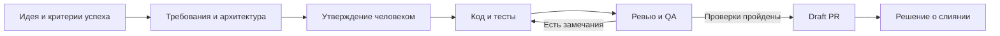

# Агентная команда для OpenCode

**От продуктовой задачи до проверенного изменения кода — с контролем человека.**

Команда из 10 AI-агентов помогает пройти весь цикл разработки: уточнить требования,
подготовить архитектуру, написать код, выполнить ревью и проверить результат.
На выходе — черновик запроса на слияние (draft PR), документы и результаты проверок.

Вы определяете, **что и зачем сделать**. Агенты выполняют работу по ролям.
Вы утверждаете требования и принимаете решение о слиянии кода.

**Версия: [v2.0.0](https://github.com/oElshan/agents/releases/tag/v2.0.0)** ·
[Подключение и обновление](#подключение) · [Руководство](docs/operator-guide.md) ·
[Изменения версии](CHANGELOG.md)

## Что получает продуктовая команда

| Потребность | Как помогает система |
|---|---|
| Перевести идею в задачу для разработки | Аналитик готовит требования, критерии приёмки и небольшие задачи. |
| Сохранить связь между ожиданиями и результатом | Каждый критерий получает ID. На него ссылаются задачи и QA-отчёты. |
| Снизить объём ручной координации | Оркестратор выбирает следующий шаг, передаёт замечания и ведёт доску. |
| Сделать проверку работы понятной | Отдельные агенты проверяют безопасность, код и поведение приложения. |
| Управлять затратами на модели | Для каждой роли можно задать свою модель и провайдера. |
| Сохранить контроль над изменениями | Человек выбирает задачи, утверждает требования и сливает PR. |

Цель — сократить повторяющуюся работу между постановкой задачи и проверкой результата.
Проект не обещает фиксированное ускорение или экономию: они зависят от репозитория,
моделей, качества требований и доступных тестов.

## Как проходит задача



Например, вы ставите задачу: «Дать менеджеру экспорт заказов с учётом его прав доступа».
Агенты уточняют формат экспорта и ограничения, делят работу на задачи, реализуют их
и проверяют критерии приёмки. В PR видны изменения, результаты проверок и то, что осталось непроверенным.

По умолчанию требования ждут вашего `/approve`. Задачи выполняются последовательно.
Если проверка не пройдена, система возвращает работу на доработку или останавливается с причиной.
Деплой на staging можно подключить отдельно. Production не автоматизируется.

## Что остаётся после работы

- Спецификация с критериями приёмки и декомпозицией.
- Архитектурные решения и границы изменения.
- Код и тесты в отдельной ветке.
- Результаты ревью и QA, связанные с версией кода.
- Draft PR для проверки и слияния человеком.

Статус `Done` означает завершение предусмотренного этапа агентного процесса.
Он **не означает**, что изменение уже слито или выпущено в production.

## Команда агентов

| Роль | Ответственность |
|---|---|
| Оркестратор | Координация, доска, проверки этапов, ветки и подготовка PR. |
| Аналитик | Требования, критерии приёмки и декомпозиция. |
| Архитектор | Архитектура, ограничения и решения по интеграциям. |
| Разработчик | Реализация и тесты. |
| Три проверяющих | Безопасность, backend и frontend. |
| Тестировщик | Проверка критериев приёмки и регрессии. |
| DevOps | Проверка и развёртывание артефактов на staging. |
| E2E-тестировщик | Браузерные тесты по отдельной команде `/e2e`. |

Состав проверок зависит от изменённых компонентов. Модели задаются по ролям,
а команды сборки, тестов и пороги качества — в профиле проекта.
[Настройка моделей и качества →](docs/operator-guide.md#модели-и-качество)

## Контроль качества

Версия 2.0 добавляет исполняемые проверки на Python:

| Контроль | Что проверяется |
|---|---|
| Версия требований | Спецификация, архитектура и правила соответствуют утверждённому снимку. |
| Актуальность ревью | Результат относится к текущему коду. Изменение тестов требует новой проверки. |
| Покрытие | JaCoCo XML обновлён и содержит все изменённые исходные файлы. |
| Миграции БД | Существующие миграции сохранены; новый include в Liquibase XML разрешён. |
| Стенд | Ошибка health или получения логов не выдаётся за успех. |
| Staging | Версия кода и контрольные суммы артефактов совпадают с ожидаемыми. |

Эти проверки дополняют работу агентов. Пока вызов проверок и смена статусов зависят
от оркестратора. Полная изоляция доступа к файлам и транзакции доски ещё не реализованы.
[Технические границы проверок →](.opencode/lib/README.md#границы)

## Кому подходит

Основной набор правил подготовлен для **Java/Kotlin, Spring, Angular и React**.
Система подходит для команды, у которой уже есть Git-репозиторий, команды сборки и тестов,
а также инженер, который проверит профиль и итоговый PR.

Для другого стека потребуется адаптировать инструкции и проверки. Сейчас поддерживается
одна активная задача разработки в рабочем каталоге. Браузерные E2E запускаются отдельно.
Доска может работать локально или отражаться в GitHub Issues и Projects.

## Подключение

Нужны OpenCode, Git, Python 3.9+, Bash и доступ к модели с вызовом инструментов.
Для PR и синхронизации GitHub нужен `gh`. Загрузка агентов проверена на OpenCode 2.0.29.

В чистом репозитории с хотя бы одним коммитом:

```bash
git subtree add --prefix=.opencode https://github.com/oElshan/agents.git v2.0.0 --squash
opencode auth login
opencode models
opencode
```

Каталог `.opencode` не должен существовать перед `subtree add`.
Выберите модель в OpenCode. Существующий `opencode.json` не перезаписывайте.

Первый запуск в OpenCode:

```text
/setup
/feature Экспорт заказов для менеджера с учётом прав доступа
/sprint add <id>
/orchestrate
/approve <id>
/orchestrate
```

`/setup` помогает определить стек и подготовить профиль. Перед `/approve` прочитайте
спецификацию и архитектуру. Для пилота выберите небольшую задачу с проверяемым результатом.

## Обновление с версии 1.x

Обновление требует изменения профиля. Завершите текущий запуск агентов,
сохраните изменения проекта и резервную копию `.agents/board` и `.agents/cache`.
Эти каталоги обычно не входят в Git.

Если фреймворк подключён через subtree:

```bash
git subtree pull --prefix=.opencode https://github.com/oElshan/agents.git v2.0.0 --squash
PYTHONDONTWRITEBYTECODE=1 python3 -m unittest discover -s .opencode/tests -q
```

После обновления:

1. Замените CSV-настройку покрытия на `coverage_sources` с путями JaCoCo XML.
2. Если используете staging, настройте подготовку и проверку digest артефактов.
3. Для активных фич повторите G2 и утверждение документов.
4. Получите заново результаты, для которых нет проверяемой версии кода.

[Точный порядок перехода и пример профиля →](.opencode/lib/README.md#обновление-существующего-проекта)

## Проверено и запланировано

Для версии 2.0 локально прошли 35 тестов проверок. OpenCode загрузил все 10 проектных агентов.
Добавлен CI на Python 3.9 и 3.13. Полный цикл агентов и staging с новыми проверками
пока не подтверждён. Начинайте с пилота в отдельном клоне проекта.

Следующие направления: изоляция прав, устойчивое хранение состояния, оценки качества
агентов и проверка фактической модели каждого запуска.

[Руководство оператора](docs/operator-guide.md) · [История изменений](CHANGELOG.md) ·
[Порядок выпуска](docs/releasing.md)
