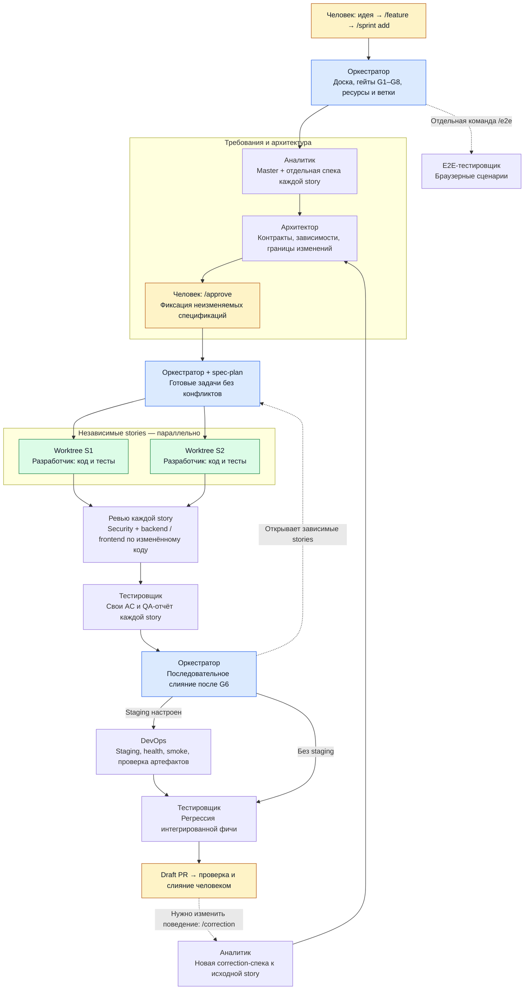

# Агентная команда для OpenCode

**От продуктовой задачи до проверенного изменения кода — с контролем человека.**

Команда из 10 AI-агентов помогает пройти весь цикл разработки: уточнить требования,
подготовить архитектуру, написать код, выполнить ревью и проверить результат.
На выходе — черновик запроса на слияние (draft PR), документы и результаты проверок.

Вы определяете, **что и зачем сделать**. Агенты выполняют работу по ролям.
Вы утверждаете требования и принимаете решение о слиянии кода.

**Версия: [v2.1.0](https://github.com/oElshan/agents/releases/tag/v2.1.0)** ·
[Подключение и обновление](#подключение) · [Руководство](docs/operator-guide.md) ·
[Изменения версии](CHANGELOG.md)

В версии 2.1 добавлены отдельные story-спецификации, corrections и планирование
параллельной работы. Для перехода с 2.0 см. [миграцию спецификаций](#переход-на-дерево-спецификаций).

## Что получает продуктовая команда

| Потребность | Как помогает система |
|---|---|
| Перевести идею в задачу для разработки | Аналитик готовит требования, критерии приёмки и небольшие задачи. |
| Сохранить связь между ожиданиями и результатом | Каждый критерий получает ID. На него ссылаются задачи и QA-отчёты. |
| Снизить объём ручной координации | Оркестратор выбирает следующий шаг, передаёт замечания и ведёт доску. |
| Сделать проверку работы понятной | Отдельные агенты проверяют безопасность, код и поведение приложения. |
| Управлять затратами на модели | Для каждой роли можно задать свою модель и провайдера. |
| Сохранить контроль над изменениями | Человек выбирает задачи, утверждает требования и сливает PR. |

Цель — сократить повторяющуюся работу между постановкой задачи и проверкой результата.
Проект не обещает фиксированное ускорение или экономию: они зависят от репозитория,
моделей, качества требований и доступных тестов.

## Схема системы



Оркестратор — единственный владелец доски и очереди слияния. Он передаёт каждому агенту
его спецификацию, критерии приёмки (AC), рабочий каталог и разрешённую область изменения.
Ревью и QA выполняются для каждой story отдельно; общий узел на схеме обозначает стадию,
а не общий файл отчёта. Ошибка проверки возвращает соответствующую story на доработку.

## Как проходит задача

Например, вы ставите задачу: «Дать менеджеру экспорт заказов с учётом его прав доступа».
Агенты уточняют формат экспорта и ограничения, делят работу на задачи, реализуют их
и проверяют критерии приёмки. В PR видны изменения, результаты проверок и то, что осталось непроверенным.

По умолчанию требования ждут вашего `/approve`. Фича получает master-спеку, а каждая
story — собственную спецификацию. Независимые stories выполняются параллельно в отдельных
worktree; зависимости и общие ресурсы задают последовательность.
Если проверка не пройдена, система возвращает работу на доработку или останавливается с причиной.
Деплой на staging можно подключить отдельно. Production не автоматизируется.

## Что остаётся после работы

- Дерево master → story → correction со ссылками и отдельными критериями приёмки каждой story.
- Архитектурные решения и границы изменения.
- Код и тесты в отдельной ветке.
- Результаты ревью и QA, связанные с версией кода.
- Draft PR для проверки и слияния человеком.

Статус `Done` означает завершение предусмотренного этапа агентного процесса.
Он **не означает**, что изменение уже слито или выпущено в production.

## Команда агентов

| Роль | Ответственность |
|---|---|
| Оркестратор | Доска, гейты, планирование по графу, отдельные worktree, ресурсы, последовательное слияние и PR. |
| Аналитик | Master, отдельные story/correction-спеки, критерии приёмки, зависимости и блокеры. |
| Архитектор | Общие контракты, архитектура, проверка зависимостей и конфликтов между stories. |
| Разработчик | Реализация и тесты своей story/correction в назначенном worktree и области файлов. |
| Три проверяющих | Безопасность, backend и frontend. |
| Тестировщик | Проверка критериев приёмки и регрессии. |
| DevOps | Проверка и развёртывание артефактов на staging. |
| E2E-тестировщик | Браузерные тесты по отдельной команде `/e2e`. |

Состав проверок зависит от изменённых компонентов. Модели задаются по ролям,
а команды сборки, тестов и пороги качества — в профиле проекта.
[Настройка моделей и качества →](docs/operator-guide.md#модели-и-качество)

## Спецификации и изменения поведения

Каждая фича всегда реализуется через stories, даже если story всего одна. Story — минимальная
единица нового функционала, которую можно отдельно реализовать и проверить. Общая спецификация
фичи больше не содержит все AC и детали реализации в одном файле.

| Уровень | Что содержит | Как используется |
|---|---|---|
| **Master** | Цель фичи, общие ограничения и контракты, ссылки на stories. | Связывает работу в одну фичу; напрямую в разработку не поступает. |
| **Story** | Собственный функционал, AC, системные решения, зависимости, блокеры, границы файлов и план проверки. | Получает отдельную карточку, снимок утверждения, worktree и QA-отчёт. |
| **Correction** | Причину изменения поведения, старое → новое, новые AC и ссылки на заменяемые требования. | Принадлежит исходной story и реализуется отдельной story-карточкой со своим циклом проверок. |

Пример хранения:

```text
docs/specs/F12-export/
├── master.md
├── stories/
│   ├── S1-csv.md
│   ├── S2-json.md
│   └── S3-download-ui.md
└── corrections/
    ├── S1-C1-format.md
    └── S1-C2-encoding.md
```

Логическое дерево — **master → story → correction**. Связь `parent` задаёт родителя,
`depends_on` — обязательные предварительные результаты. Последующая correction остаётся
дочерней исходной story, а через `corrects` может ссылаться на предыдущую correction.
Поле `supersedes` перечисляет заменяемые AC.

Файлы — обычный Markdown в Git с frontmatter `schema: spec/v1` и полными wikilinks,
например `[[docs/specs/F12-export/stories/S1-csv]]`. Репозиторий можно открыть как Obsidian
vault: ссылки и обратные связи покажут граф требований. Статусы выполнения и результаты
проверок хранятся в карточках и QA, поэтому для обновления статуса не нужно менять спецификацию.

### Как меняется реализованное поведение

После первого утверждения спеки неизменяемы: прежние AC, ссылки и файлы не переписываются.
Чтобы изменить ожидаемое поведение, создайте correction:

```text
/correction <id исходной story> Изменить формат CSV-экспорта
/sprint add <id correction-карточки>
/orchestrate <id correction-карточки>
/approve <id correction-карточки>
/orchestrate <id correction-карточки>
```

Correction проходит анализ, утверждение, разработку, ревью и QA отдельно. Новые требования
заменяют прежние в общей регрессии только после интеграции correction. Для проверки самой
correction используется будущий набор AC. Если код нарушает уже действующие требования,
это bug; изменение самих требований оформляется correction.

Для уже завершённой фичи correction получает отдельную ветку изменения и PR. Исходный PR
должен быть слит в базовую ветку; один только статус `Done` этого не подтверждает.

[Формат, примеры и переход со старых спек](.opencode/skills/write-spec/references/spec-graph.md) ·
[Шаблоны спецификаций](.opencode/skills/write-spec/SKILL.md)

## Что выполняется параллельно

Оркестратор запускает независимые stories в отдельных worktree. В примере выше CSV (S1)
и JSON (S2) могут разрабатываться одновременно, если их файлы и ресурсы не конфликтуют.
Если интерфейсу скачивания (S3) нужны оба результата, он ждёт интеграции S1 и S2.

| Связь или ограничение | Решение оркестратора |
|---|---|
| `depends_on` | Ждать, пока результаты prerequisites пройдут G6 и войдут в базу задачи. |
| `blockers` | Ждать подтверждённого закрытия внешнего условия на доске. |
| Пересечение `writes` / `reads` | Не запускать одновременно изменение и использование одних файлов. |
| Общие `resources` | Сериализовать работу с общим API, DTO, таблицей, миграцией или другим ресурсом. |
| Общий стенд или staging | Выполнять проверки по одному, пока изоляция окружений не подтверждена. |

В новых профилях `orchestrator.parallel_stories: 2`; значение `1` включает последовательный
режим. Старый профиль без этого поля работает последовательно до настройки через `/setup`.
Если среда запуска не обеспечивает отдельный рабочий каталог каждому агенту, используется
последовательный режим.

Слияние результатов всегда выполняет один оркестратор. Если база story изменилась после
её проверки, он обновляет ветку и повторяет гейты, ревью и QA. Каждый QA-отчёт имеет свой
путь: `docs/qa/F12/S1.md`, `S2.md`, `S1-C1.md`; регрессия фичи — `docs/qa/F12/regression.md`.

[Правила параллельной работы и изоляции](.opencode/skills/parallel-stories/SKILL.md).

## Контроль качества

Проверки версии 2.0 дополнены проверками графа спецификаций и границ stories.
CLI на Python возвращает `PASS`, `FAIL` или `ERROR`; ошибка проверки блокирует переход.

| Контроль | Что проверяется |
|---|---|
| Версия требований | Спецификация, архитектура и правила соответствуют утверждённому снимку. |
| Граф спецификаций — `spec-graph` | Иерархия, ссылки, уникальные AC, отсутствие циклов и конкурирующих corrections; с baseline — неизменность утверждённых спек. |
| План запуска — `spec-plan` | Зависимости, внешние блокеры, пересечения файлов и ресурсов, доступные слоты. |
| Действующие требования — `spec-effective` | Набор AC с учётом интегрированных corrections и заменённых требований. |
| Область изменения — `spec-scope` | Фактический diff укладывается в заявленные файлы story/correction. |
| Актуальность ревью | Результат относится к текущему коду. Изменение тестов требует новой проверки. |
| Покрытие | JaCoCo XML обновлён и содержит все изменённые исходные файлы. |
| Миграции БД | Существующие миграции сохранены; новый include в Liquibase XML разрешён. |
| Стенд | Ошибка health или получения логов не выдаётся за успех. |
| Staging | Версия кода и контрольные суммы артефактов совпадают с ожидаемыми. |

Эти проверки дополняют работу агентов. Пока вызов проверок и смена статусов зависят
от оркестратора. Полная изоляция доступа к файлам и транзакции доски ещё не реализованы.
[Технические границы проверок →](.opencode/lib/README.md#границы)

## Кому подходит

Основной набор правил подготовлен для **Java/Kotlin, Spring, Angular и React**.
Система подходит для команды, у которой уже есть Git-репозиторий, команды сборки и тестов,
а также инженер, который проверит профиль и итоговый PR.

Для другого стека потребуется адаптировать инструкции и проверки. Сейчас поддерживается
один агент-писатель на worktree и один оркестратор на доску. Число параллельных stories
задаёт профиль; общий стенд проверяется последовательно, если не настроена его изоляция.
Браузерные E2E запускаются отдельно.
Доска может работать локально или отражаться в GitHub Issues и Projects.

## Подключение

Нужны OpenCode, Git, Python 3.9+, Bash и доступ к модели с вызовом инструментов.
Для PR и синхронизации GitHub нужен `gh`. Загрузка агентов проверена на OpenCode 2.2.5.

В чистом репозитории с хотя бы одним коммитом:

```bash
git subtree add --prefix=.opencode https://github.com/oElshan/agents.git v2.1.0 --squash
opencode auth login
opencode models
opencode
```

Каталог `.opencode` не должен существовать перед `subtree add`.
Выберите модель в OpenCode. Существующий `opencode.json` не перезаписывайте.

Первый запуск в OpenCode:

```text
/setup
/feature Экспорт заказов для менеджера с учётом прав доступа
/sprint add <id>
/orchestrate
/approve <id>
/orchestrate
```

`/setup` помогает определить стек и подготовить профиль. Перед `/approve` прочитайте
спецификацию и архитектуру. Для пилота выберите небольшую задачу с проверяемым результатом.

## Обновление с версии 1.x

Обновление требует изменения профиля. Завершите текущий запуск агентов,
сохраните изменения проекта и резервную копию `.agents/board` и `.agents/cache`.
Эти каталоги обычно не входят в Git.

Если фреймворк подключён через subtree:

```bash
git subtree pull --prefix=.opencode https://github.com/oElshan/agents.git v2.1.0 --squash
PYTHONDONTWRITEBYTECODE=1 python3 -m unittest discover -s .opencode/tests -q
```

После обновления:

1. Замените CSV-настройку покрытия на `coverage_sources` с путями JaCoCo XML.
2. Если используете staging, настройте подготовку и проверку digest артефактов.
3. Для активных фич повторите G2 и утверждение документов.
4. Получите заново результаты, для которых нет проверяемой версии кода.

[Точный порядок перехода и пример профиля →](.opencode/lib/README.md#обновление-существующего-проекта)

### Переход на дерево спецификаций

Перед обновлением до v2.1.0 завершите активный запуск агентов
и сохраните доску. После обновления старую монолитную спецификацию не редактируйте и не удаляйте: создайте
master и отдельные story-файлы со ссылкой на источник и явной таблицей старых и новых AC.
Для незавершённых задач нужны G2, утверждение новых контрактов и актуальные проверки.
Исторический QA нельзя автоматически объявить PASS для новых AC.

Настройте параллельность через `/setup`. Начните с `parallel_stories: 1`, если изоляция
рабочих каталогов ещё не проверена; затем увеличьте лимит. Общий стенд остаётся последовательным,
пока не подтверждены отдельные порты, БД и окружения каждой задачи.

[Подробный порядок миграции](.opencode/skills/write-spec/references/spec-graph.md#переход-со-старой-монолитной-спеки).

## Проверено и запланировано

Для версии 2.1 локально прошли **63 теста**: существующие гейты и новые проверки
графа, снимков, зависимостей, конфликтов, corrections, действующих AC и областей изменения.
Те же 63 теста прошли после чистой установки и обновления subtree с v2.0.0; локальные настройки,
доска, кэш и дополнительный файл пакета сохранились. OpenCode 2.2.5 загрузил все 10 проектных агентов.
Проверены YAML-заголовки агентов, команд и скиллов, а также согласованность разрешений скиллов.
Полный параллельный цикл нескольких агентов в OpenCode на реальном проекте ещё не проверен.

Для версии 2.0 прошли 35 тестов проверок. Проверены установка с нуля и обновление subtree
с v1.0.2 с сохранением локальных настроек и доски. OpenCode загрузил все 10 проектных агентов.
Добавлен CI на Python 3.9 и 3.13. Полный цикл агентов и staging с новыми проверками
пока не подтверждён. Начинайте с пилота в отдельном клоне проекта.

Следующие направления: изоляция прав, устойчивое хранение состояния, оценки качества
агентов и проверка фактической модели каждого запуска.

[Согласованный состав работ](docs/work-plan.md): пилотные прогоны, исправления по результатам,
подбор режимов агентов, Confluence, Jira/GitLab и YouTrack, поставка во второй проект.
План зафиксирован 4 ноября 2026; выполнение отложено до отдельного запроса пользователя.

[Руководство оператора](docs/operator-guide.md) · [История изменений](CHANGELOG.md) ·
[Порядок выпуска](docs/releasing.md)
